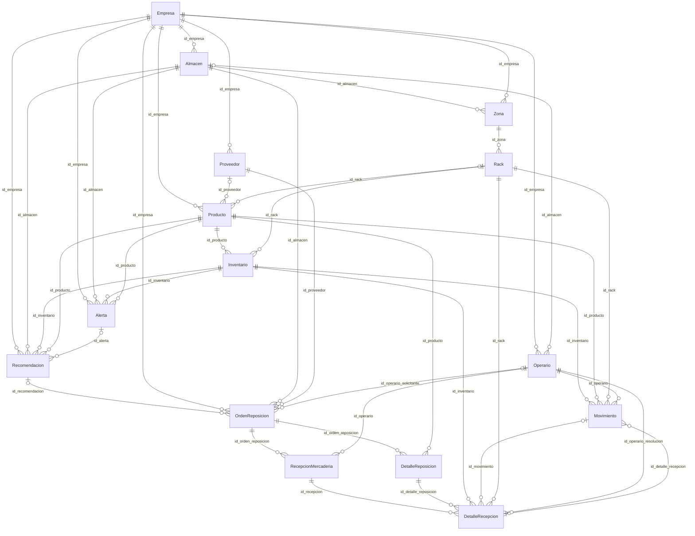
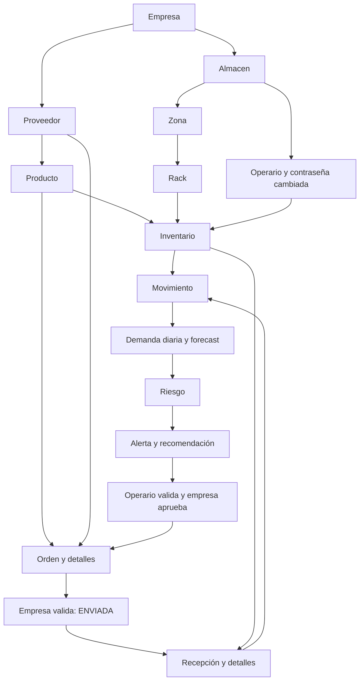

# Relaciones reales de PsiTwin

Fecha de auditoría: 2026-10-13 (America/Lima). Inspección estática del workspace real. No se ejecutó el backend, no se importó app.main, no se abrió una conexión a MongoDB, no se entrenaron modelos, no se generaron registros ni datasets. Los JSON son ejemplos documentales ilustrativos. IMPLEMENTADO significa presencia y trazabilidad en código; no acredita ejecución exitosa ni datos desplegados. NO DEFINIDA significa ausencia de restricción declarada en ese contrato; NO VERIFICABLE significa falta de evidencia de ejecución o del despliegue. INFERIDO se reserva para cardinalidades y efectos deducidos. PARCIALMENTE IMPLEMENTADO distingue código existente con componentes faltantes. NO IMPLEMENTADO se limita al alcance inspeccionado.

El diagrama expresa referencias lógicas escalares. No representa claves foráneas MongoDB ni valida por sí mismo existencia, pertenencia o cardinalidad. Las cardinalidades inversas son INFERIDAS. Almacen/Zona usan id en persistencia; otros campos id_almacen/id_zona son referencias.

## Inventario distribuido

IMPLEMENTADO: Producto es un registro comercial de empresa/proveedor, Inventario es saldo físico de producto en rack. Un id_producto tiene 0..N inventarios; cada inventario referencia un solo rack. El mismo producto puede estar en varias zonas y almacenes de la empresa. Se rechaza repetir producto+rack por servicio, no por índice compuesto. Producto.id_rack es una referencia opcional única y no sustituye esta relación N:M con ubicaciones. No hay SKU/EAN/código comercial obligatorio ni unicidad por nombre; dos productos con nombre idéntico siguen siendo IDs distintos. Agregados ML de almacén tienen la limitación INC-07.

## Tabla exhaustiva de referencias

| Origen | Destino | Campo exacto | Cardinalidad | Existencia | Índice | Borrado | Evidencia |
|---|---|---|---|---|---|---|---|
| Almacen | Empresa | id_empresa | N:1 lógica; inversa 1:0..N (INFERIDO, sin FK MongoDB) | IMPLEMENTADO en flujo de creación; ver service y controller | NO DEFINIDO para esta relación | Sin cascade MongoDB; inspeccionar restricciones de eliminación por endpoint | app/controllers/almacen_controller.py:48 _almacenes_visibles; app/controllers/almacen_controller.py:88 crear_almacen; app/controllers/almacen_controller.py:120 obtener_almacenes |
| Zona | Almacen | id_almacen | N:1 lógica; inversa 1:0..N (INFERIDO, sin FK MongoDB) | IMPLEMENTADO en flujo de creación; ver service y controller | NO DEFINIDO para esta relación | Sin cascade MongoDB; inspeccionar restricciones de eliminación por endpoint | app/controllers/zona_controller.py:52 crear_zona; app/controllers/zona_controller.py:113 obtener_zonas_por_almacen; app/repositories/zona_repository.py:124 obtener_por_almacen |
| Zona | Empresa | id_empresa | N:1 lógica; inversa 1:0..N (INFERIDO, sin FK MongoDB) | NO GARANTIZADA; campo almacenado o derivado, ver contrato | NO DEFINIDO para esta relación | Sin cascade MongoDB; inspeccionar restricciones de eliminación por endpoint | app/services/zona_service.py:46 normalizar_zona; app/services/zona_service.py:104 crear |
| Rack | Zona | id_zona | N:1 lógica; inversa 1:0..N (INFERIDO, sin FK MongoDB) | IMPLEMENTADO en flujo de creación; ver service y controller | NO DEFINIDO para esta relación | Sin cascade MongoDB; inspeccionar restricciones de eliminación por endpoint | app/controllers/rack_controller.py:51 crear_rack; app/controllers/rack_controller.py:166 obtener_racks_zona; app/repositories/rack_repository.py:130 obtener_por_zona |
| Producto | Empresa | id_empresa | N:1 lógica; inversa 1:0..N (INFERIDO, sin FK MongoDB) | IMPLEMENTADO en flujo de creación; ver service y controller | NO DEFINIDO para esta relación | Sin cascade MongoDB; inspeccionar restricciones de eliminación por endpoint | app/controllers/producto_controller.py:94 crear_producto; app/services/producto_service.py:42 crear |
| Producto | Proveedor | id_proveedor | N:1 lógica; inversa 1:0..N (INFERIDO, sin FK MongoDB) | NO GARANTIZADA; campo almacenado o derivado, ver contrato | NO DEFINIDO para esta relación | Sin cascade MongoDB; inspeccionar restricciones de eliminación por endpoint | app/controllers/producto_controller.py:49 _visibles; app/controllers/producto_controller.py:94 crear_producto |
| Producto | Rack | id_rack | N:1 lógica; inversa 1:0..N (INFERIDO, sin FK MongoDB) | IMPLEMENTADO en flujo de creación; ver service y controller | NO DEFINIDO para esta relación | Sin cascade MongoDB; inspeccionar restricciones de eliminación por endpoint | app/controllers/producto_controller.py:94 crear_producto; app/controllers/producto_controller.py:217 obtener_productos_por_rack; app/controllers/producto_controller.py:279 obtener_producto |
| Inventario | Producto | id_producto | N:1 lógica; inversa 1:0..N (INFERIDO, sin FK MongoDB) | IMPLEMENTADO en flujo de creación; ver service y controller | NO DEFINIDO para esta relación | El controller/service de destino bloquea borrado si tiene inventarios | app/controllers/inventario_controller.py:66 crear_inventario; app/controllers/inventario_controller.py:187 obtener_inventario_producto; app/repositories/inventario_repository.py:42 crear |
| Inventario | Rack | id_rack | N:1 lógica; inversa 1:0..N (INFERIDO, sin FK MongoDB) | IMPLEMENTADO en flujo de creación; ver service y controller | NO DEFINIDO para esta relación | El controller/service de destino bloquea borrado si tiene inventarios | app/controllers/inventario_controller.py:41 _filtrar_alcance; app/controllers/inventario_controller.py:66 crear_inventario; app/controllers/inventario_controller.py:217 obtener_inventario_rack |
| Operario | Empresa | id_empresa | N:1 lógica; inversa 1:0..N (INFERIDO, sin FK MongoDB) | IMPLEMENTADO en flujo de creación; ver service y controller | NO DEFINIDO para esta relación | Sin cascade MongoDB; inspeccionar restricciones de eliminación por endpoint | app/controllers/operario_controller.py:107 obtener_por_empresa; app/repositories/operario_repository.py:24 crear; app/repositories/operario_repository.py:184 obtener_por_empresa |
| Operario | Almacen | id_almacen | N:1 lógica; inversa 1:0..N (INFERIDO, sin FK MongoDB) | IMPLEMENTADO en flujo de creación; ver service y controller | NO DEFINIDO para esta relación | Sin cascade MongoDB; inspeccionar restricciones de eliminación por endpoint | app/repositories/operario_repository.py:24 crear; app/services/operario_service.py:93 validar_almacen; app/services/operario_service.py:129 crear_operario |
| Movimiento | Inventario | id_inventario | N:1 lógica; inversa 1:0..N (INFERIDO, sin FK MongoDB) | IMPLEMENTADO en flujo de creación; ver service y controller | NO DEFINIDO para esta relación | Sin cascade MongoDB; inspeccionar restricciones de eliminación por endpoint | app/controllers/movimiento_controller.py:79 crear_movimiento; app/controllers/movimiento_controller.py:150 obtener_por_inventario; app/repositories/movimiento_repository.py:154 obtener_por_inventario |
| Movimiento | DetalleRecepcion | id_detalle_recepcion | N:1 lógica; inversa 1:0..N (INFERIDO, sin FK MongoDB) | NO GARANTIZADA; campo almacenado o derivado, ver contrato | unique parcial declarado | Sin cascade MongoDB; inspeccionar restricciones de eliminación por endpoint | app/controllers/movimiento_controller.py:79 crear_movimiento; app/repositories/movimiento_repository.py:124 obtener_por_detalle_recepcion; app/services/movimiento_service.py:123 crear_movimiento |
| Movimiento | Producto | id_producto | N:1 lógica; inversa 1:0..N (INFERIDO, sin FK MongoDB) | NO GARANTIZADA; campo almacenado o derivado, ver contrato | NO DEFINIDO para esta relación | Sin cascade MongoDB; inspeccionar restricciones de eliminación por endpoint | app/controllers/movimiento_controller.py:177 obtener_por_producto; app/repositories/movimiento_repository.py:185 obtener_por_producto; app/repositories/movimiento_repository.py:418 obtener_por_producto_y_rango |
| Movimiento | Rack | id_rack | N:1 lógica; inversa 1:0..N (INFERIDO, sin FK MongoDB) | NO GARANTIZADA; campo almacenado o derivado, ver contrato | NO DEFINIDO para esta relación | Sin cascade MongoDB; inspeccionar restricciones de eliminación por endpoint | app/controllers/movimiento_controller.py:50 _filtrar_alcance; app/controllers/movimiento_controller.py:205 obtener_por_rack; app/controllers/movimiento_controller.py:307 obtener_movimiento |
| Movimiento | Operario | id_operario | N:1 lógica; inversa 1:0..N (INFERIDO, sin FK MongoDB) | IMPLEMENTADO en flujo de creación; ver service y controller | NO DEFINIDO para esta relación | Sin cascade MongoDB; inspeccionar restricciones de eliminación por endpoint | app/controllers/movimiento_controller.py:232 obtener_por_operario; app/repositories/movimiento_repository.py:247 obtener_por_operario; app/services/movimiento_service.py:123 crear_movimiento |
| Proveedor | Empresa | id_empresa | N:1 lógica; inversa 1:0..N (INFERIDO, sin FK MongoDB) | IMPLEMENTADO en flujo de creación; ver service y controller | NO DEFINIDO para esta relación | Sin cascade MongoDB; inspeccionar restricciones de eliminación por endpoint | app/controllers/proveedor_controller.py:72 crear; app/controllers/proveedor_controller.py:84 obtener_todos; app/controllers/proveedor_controller.py:98 obtener_por_empresa |
| OrdenReposicion | Recomendacion | id_recomendacion | N:1 lógica; inversa 1:0..N (INFERIDO, sin FK MongoDB) | NO GARANTIZADA; campo almacenado o derivado, ver contrato | NO DEFINIDO para esta relación | Sin cascade MongoDB; inspeccionar restricciones de eliminación por endpoint | app/controllers/orden_reposicion_controller.py:89 crear; app/repositories/orden_reposicion_repository.py:105 obtener_por_recomendacion |
| OrdenReposicion | Empresa | id_empresa | N:1 lógica; inversa 1:0..N (INFERIDO, sin FK MongoDB) | IMPLEMENTADO en flujo de creación; ver service y controller | NO DEFINIDO para esta relación | Sin cascade MongoDB; inspeccionar restricciones de eliminación por endpoint | app/controllers/orden_reposicion_controller.py:89 crear; app/controllers/orden_reposicion_controller.py:113 obtener_todos; app/controllers/orden_reposicion_controller.py:146 obtener_por_empresa |
| OrdenReposicion | Almacen | id_almacen | N:1 lógica; inversa 1:0..N (INFERIDO, sin FK MongoDB) | IMPLEMENTADO en flujo de creación; ver service y controller | NO DEFINIDO para esta relación | Sin cascade MongoDB; inspeccionar restricciones de eliminación por endpoint | app/controllers/orden_reposicion_controller.py:56 _alcance; app/controllers/orden_reposicion_controller.py:89 crear; app/controllers/orden_reposicion_controller.py:161 obtener_por_almacen |
| OrdenReposicion | Proveedor | id_proveedor | N:1 lógica; inversa 1:0..N (INFERIDO, sin FK MongoDB) | IMPLEMENTADO en flujo de creación; ver service y controller | NO DEFINIDO para esta relación | Sin cascade MongoDB; inspeccionar restricciones de eliminación por endpoint | app/controllers/orden_reposicion_controller.py:113 obtener_todos; app/controllers/orden_reposicion_controller.py:134 obtener_proveedor_me; app/controllers/orden_reposicion_controller.py:173 obtener_por_proveedor |
| OrdenReposicion | Operario | id_operario_solicitante | N:1 lógica; inversa 1:0..N (INFERIDO, sin FK MongoDB) | NO GARANTIZADA; campo almacenado o derivado, ver contrato | NO DEFINIDO para esta relación | Sin cascade MongoDB; inspeccionar restricciones de eliminación por endpoint | app/services/orden_reposicion_service.py:34 __init__; app/services/orden_reposicion_service.py:47 crear |
| DetalleReposicion | OrdenReposicion | id_orden_reposicion | N:1 lógica; inversa 1:0..N (INFERIDO, sin FK MongoDB) | IMPLEMENTADO en flujo de creación; ver service y controller | NO DEFINIDO para esta relación | Sin cascade MongoDB; inspeccionar restricciones de eliminación por endpoint | app/controllers/detalle_reposicion_controller.py:40 _verificar_detalle; app/repositories/detalle_reposicion_repository.py:37 obtener_por_orden; app/repositories/detalle_reposicion_repository.py:46 obtener_producto_en_orden |
| DetalleReposicion | Producto | id_producto | N:1 lógica; inversa 1:0..N (INFERIDO, sin FK MongoDB) | IMPLEMENTADO en flujo de creación; ver service y controller | NO DEFINIDO para esta relación | Sin cascade MongoDB; inspeccionar restricciones de eliminación por endpoint | app/controllers/detalle_reposicion_controller.py:59 crear; app/repositories/detalle_reposicion_repository.py:46 obtener_producto_en_orden; app/services/detalle_reposicion_service.py:25 crear |
| RecepcionMercaderia | OrdenReposicion | id_orden_reposicion | N:1 lógica; inversa 1:0..N (INFERIDO, sin FK MongoDB) | IMPLEMENTADO en flujo de creación; ver service y controller | NO DEFINIDO para esta relación | Sin cascade MongoDB; inspeccionar restricciones de eliminación por endpoint | app/controllers/recepcion_mercaderia_controller.py:67 obtener_todos; app/repositories/recepcion_mercaderia_repository.py:36 obtener_por_ordenes; app/repositories/recepcion_mercaderia_repository.py:61 obtener_por_orden |
| RecepcionMercaderia | Operario | id_operario | N:1 lógica; inversa 1:0..N (INFERIDO, sin FK MongoDB) | IMPLEMENTADO en flujo de creación; ver service y controller | NO DEFINIDO para esta relación | Sin cascade MongoDB; inspeccionar restricciones de eliminación por endpoint | app/controllers/recepcion_mercaderia_controller.py:103 obtener_por_operario; app/repositories/recepcion_mercaderia_repository.py:70 obtener_por_operario; app/services/recepcion_mercaderia_service.py:59 crear |
| DetalleRecepcion | RecepcionMercaderia | id_recepcion | N:1 lógica; inversa 1:0..N (INFERIDO, sin FK MongoDB) | IMPLEMENTADO en flujo de creación; ver service y controller | NO DEFINIDO para esta relación | Sin cascade MongoDB; inspeccionar restricciones de eliminación por endpoint | app/controllers/detalle_recepcion_controller.py:39 _verificar_detalle; app/controllers/detalle_recepcion_controller.py:64 crear; app/controllers/detalle_recepcion_controller.py:90 obtener_por_recepcion |
| DetalleRecepcion | DetalleReposicion | id_detalle_reposicion | N:1 lógica; inversa 1:0..N (INFERIDO, sin FK MongoDB) | IMPLEMENTADO en flujo de creación; ver service y controller | NO DEFINIDO para esta relación | Sin cascade MongoDB; inspeccionar restricciones de eliminación por endpoint | app/repositories/detalle_recepcion_repository.py:48 obtener_por_detalle_reposicion; app/services/detalle_recepcion_service.py:104 crear; app/services/detalle_recepcion_service.py:696 _recalcular_estado_orden |
| DetalleRecepcion | Inventario | id_inventario | N:1 lógica; inversa 1:0..N (INFERIDO, sin FK MongoDB) | IMPLEMENTADO en flujo de creación; ver service y controller | NO DEFINIDO para esta relación | Sin cascade MongoDB; inspeccionar restricciones de eliminación por endpoint | app/controllers/detalle_recepcion_controller.py:64 crear; app/controllers/detalle_recepcion_controller.py:123 resolver_evaluacion; app/services/detalle_recepcion_service.py:104 crear |
| DetalleRecepcion | Movimiento | id_movimiento | N:1 lógica; inversa 1:0..N (INFERIDO, sin FK MongoDB) | NO GARANTIZADA; campo almacenado o derivado, ver contrato | NO DEFINIDO para esta relación | Sin cascade MongoDB; inspeccionar restricciones de eliminación por endpoint | app/repositories/detalle_recepcion_repository.py:63 actualizar_movimiento; app/services/detalle_recepcion_service.py:104 crear; app/services/detalle_recepcion_service.py:455 resolver_evaluacion |
| DetalleRecepcion | Rack | id_rack | N:1 lógica; inversa 1:0..N (INFERIDO, sin FK MongoDB) | NO GARANTIZADA; campo almacenado o derivado, ver contrato | NO DEFINIDO para esta relación | Sin cascade MongoDB; inspeccionar restricciones de eliminación por endpoint | app/services/detalle_recepcion_service.py:104 crear; app/services/detalle_recepcion_service.py:455 resolver_evaluacion |
| DetalleRecepcion | Operario | id_operario_resolucion | N:1 lógica; inversa 1:0..N (INFERIDO, sin FK MongoDB) | NO GARANTIZADA; campo almacenado o derivado, ver contrato | NO DEFINIDO para esta relación | Sin cascade MongoDB; inspeccionar restricciones de eliminación por endpoint | app/services/detalle_recepcion_service.py:455 resolver_evaluacion |
| Alerta | Empresa | id_empresa | N:1 lógica; inversa 1:0..N (INFERIDO, sin FK MongoDB) | NO GARANTIZADA; campo almacenado o derivado, ver contrato | NO DEFINIDO para esta relación | Sin cascade MongoDB; inspeccionar restricciones de eliminación por endpoint | app/controllers/alerta_controller.py:40 _verificar; app/controllers/alerta_controller.py:60 crear_alerta; app/controllers/alerta_controller.py:73 listar |
| Alerta | Almacen | id_almacen | N:1 lógica; inversa 1:0..N (INFERIDO, sin FK MongoDB) | NO GARANTIZADA; campo almacenado o derivado, ver contrato | NO DEFINIDO para esta relación | Sin cascade MongoDB; inspeccionar restricciones de eliminación por endpoint | app/controllers/alerta_controller.py:60 crear_alerta; app/controllers/alerta_controller.py:109 listar_almacen; app/repositories/alerta_repository.py:134 listar_por_almacen |
| Alerta | Inventario | id_inventario | N:1 lógica; inversa 1:0..N (INFERIDO, sin FK MongoDB) | NO GARANTIZADA; campo almacenado o derivado, ver contrato | NO DEFINIDO para esta relación | Sin cascade MongoDB; inspeccionar restricciones de eliminación por endpoint | app/controllers/alerta_controller.py:136 listar_inventario; app/repositories/alerta_repository.py:194 listar_por_inventario; app/repositories/alerta_repository.py:284 buscar_activa |
| Alerta | Producto | id_producto | N:1 lógica; inversa 1:0..N (INFERIDO, sin FK MongoDB) | NO GARANTIZADA; campo almacenado o derivado, ver contrato | NO DEFINIDO para esta relación | Sin cascade MongoDB; inspeccionar restricciones de eliminación por endpoint | app/controllers/alerta_controller.py:121 listar_producto; app/repositories/alerta_repository.py:164 listar_por_producto; app/services/alerta_service.py:23 crear |
| Recomendacion | Empresa | id_empresa | N:1 lógica; inversa 1:0..N (INFERIDO, sin FK MongoDB) | NO GARANTIZADA; campo almacenado o derivado, ver contrato | NO DEFINIDO para esta relación | Sin cascade MongoDB; inspeccionar restricciones de eliminación por endpoint | app/controllers/recomendacion_controller.py:82 _verificar; app/controllers/recomendacion_controller.py:118 crear_recomendacion; app/controllers/recomendacion_controller.py:145 listar_recomendaciones |
| Recomendacion | Almacen | id_almacen | N:1 lógica; inversa 1:0..N (INFERIDO, sin FK MongoDB) | NO GARANTIZADA; campo almacenado o derivado, ver contrato | NO DEFINIDO para esta relación | Sin cascade MongoDB; inspeccionar restricciones de eliminación por endpoint | app/controllers/recomendacion_controller.py:82 _verificar; app/controllers/recomendacion_controller.py:118 crear_recomendacion; app/controllers/recomendacion_controller.py:145 listar_recomendaciones |
| Recomendacion | Inventario | id_inventario | N:1 lógica; inversa 1:0..N (INFERIDO, sin FK MongoDB) | NO GARANTIZADA; campo almacenado o derivado, ver contrato | NO DEFINIDO para esta relación | Sin cascade MongoDB; inspeccionar restricciones de eliminación por endpoint | app/controllers/recomendacion_controller.py:251 listar_recomendaciones_inventario; app/repositories/recomendacion_repository.py:195 listar_por_inventario; app/repositories/recomendacion_repository.py:285 buscar_pendiente |
| Recomendacion | Producto | id_producto | N:1 lógica; inversa 1:0..N (INFERIDO, sin FK MongoDB) | NO GARANTIZADA; campo almacenado o derivado, ver contrato | NO DEFINIDO para esta relación | Sin cascade MongoDB; inspeccionar restricciones de eliminación por endpoint | app/controllers/recomendacion_controller.py:223 listar_recomendaciones_producto; app/repositories/recomendacion_repository.py:165 listar_por_producto; app/services/recomendacion_service.py:64 crear |
| Recomendacion | Alerta | id_alerta | N:1 lógica; inversa 1:0..N (INFERIDO, sin FK MongoDB) | NO GARANTIZADA; campo almacenado o derivado, ver contrato | NO DEFINIDO para esta relación | Sin cascade MongoDB; inspeccionar restricciones de eliminación por endpoint | app/repositories/recomendacion_repository.py:225 listar_por_alerta; app/services/recomendacion_service.py:64 crear |
| inventario_historial | Inventario | id_inventario | N:1 lógica; inversa 1:0..N (INFERIDO, sin FK MongoDB) | NO GARANTIZADA; campo almacenado o derivado, ver contrato | NO DEFINIDO para esta relación | Sin cascade MongoDB; inspeccionar restricciones de eliminación por endpoint | app/repositories/inventario_repository.py:42 crear; app/repositories/inventario_repository.py:115 obtener_por_id; app/repositories/inventario_repository.py:208 actualizar |
| inventario_historial | Operario | id_operario | N:1 lógica; inversa 1:0..N (INFERIDO, sin FK MongoDB) | NO GARANTIZADA; campo almacenado o derivado, ver contrato | NO DEFINIDO para esta relación | Sin cascade MongoDB; inspeccionar restricciones de eliminación por endpoint | app/repositories/inventario_repository.py:326 registrar_historial; app/services/inventario_service.py:45 crear_inventario; app/services/inventario_service.py:401 actualizar_inventario |
| notificaciones_email | Empresa | id_empresa | N:1 lógica; inversa 1:0..N (INFERIDO, sin FK MongoDB) | NO GARANTIZADA; campo almacenado o derivado, ver contrato | NO DEFINIDO para esta relación | Sin cascade MongoDB; inspeccionar restricciones de eliminación por endpoint | app/services/notification_service.py:27 notify_owner; app/services/notification_service.py:156 enviar_solicitud_aprobacion; app/services/notification_service.py:263 enviar_orden_proveedor |

## Dependencia de creación

1. Empresa (auth/register)
2. Almacen y Proveedor (EMPRESA)
3. Zona (EMPRESA)
4. Rack (EMPRESA)
5. Operario con cuenta temporal (EMPRESA)
6. Login de OPERARIO/PROVEEDOR y cambio de contraseña
7. Producto (PROVEEDOR; catálogo de la empresa)
8. Inventario (OPERARIO; producto + rack)
9. Movimiento (OPERARIO)
10. OrdenReposicion + DetalleReposicion (OPERARIO)
11. Validación de orden (EMPRESA) -> ENVIADA
12. Despacho informativo (PROVEEDOR; opcional)
13. RecepcionMercaderia + DetalleRecepcion (OPERARIO)
14. Resolver evaluación (OPERARIO; solo si EN_EVALUACION)
15. Alerta/Recomendacion por motor de riesgo o API de EMPRESA
16. Validación OPERARIO, aprobación EMPRESA y orden derivada

El ciclo predictivo requiere inventario previo; alerta/recomendación pueden generarse después de movimientos. No crear una orden automática antes de tener proveedor ACTIVO, producto, ubicación e inventario. Las auxiliares las producen los servicios: no requieren carga inicial.
