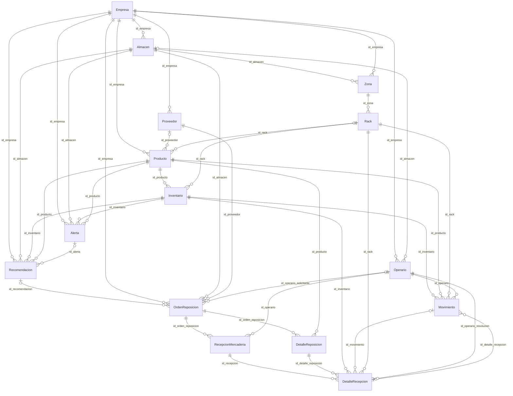

# Requisitos para un generador futuro compatible con PsiTwin

Fecha de auditoría: 2026-10-13 (America/Lima). Inspección estática del workspace real. No se ejecutó el backend, no se importó app.main, no se abrió una conexión a MongoDB, no se entrenaron modelos, no se generaron registros ni datasets. Los JSON son ejemplos documentales ilustrativos. IMPLEMENTADO significa presencia y trazabilidad en código; no acredita ejecución exitosa ni datos desplegados. NO DEFINIDA significa ausencia de restricción declarada en ese contrato; NO VERIFICABLE significa falta de evidencia de ejecución o del despliegue. INFERIDO se reserva para cardinalidades y efectos deducidos. PARCIALMENTE IMPLEMENTADO distingue código existente con componentes faltantes. NO IMPLEMENTADO se limita al alcance inspeccionado.

## ESTADO ACTUAL DEL PROYECTO

Este documento no implementa un generador ni produce datasets. Describe qué tendría que respetar una implementación posterior. Las comprobaciones previas deducidas de invariantes están marcadas como requisitos de compatibilidad, no como validadores adicionales ya instalados.

### Alcance y entidades

Crear maestros/operaciones solo a través del contrato que se elija posteriormente: por API se generan UUID, fechas, hashes y efectos; por inserción directa hipotética se deben reproducir documentos/efectos, pero el backend no proporciona importador seguro ni transacción de lote. No mezclar ambos métodos. Aquí no se usa ninguno. Las auxiliares inventario_historial, email_verifications y notificaciones_email son producidas por servicios, no tablas maestras que deban sembrarse. Forecast/InventoryRisk/Saiki y DTO anidados no son colecciones propias.

1. Empresa (auth/register)
2. Almacen y Proveedor (EMPRESA)
3. Zona (EMPRESA)
4. Rack (EMPRESA)
5. Operario con cuenta temporal (EMPRESA)
6. Login de OPERARIO/PROVEEDOR y cambio de contraseña
7. Producto (PROVEEDOR; catálogo de la empresa)
8. Inventario (OPERARIO; producto + rack)
9. Movimiento (OPERARIO)
10. OrdenReposicion + DetalleReposicion (OPERARIO)
11. Validación de orden (EMPRESA) -> ENVIADA
12. Despacho informativo (PROVEEDOR; opcional)
13. RecepcionMercaderia + DetalleRecepcion (OPERARIO)
14. Resolver evaluación (OPERARIO; solo si EN_EVALUACION)
15. Alerta/Recomendacion por motor de riesgo o API de EMPRESA
16. Validación OPERARIO, aprobación EMPRESA y orden derivada

### Validación automática previa (especificación, no código ejecutado)

1. Validar cada JSON contra DTO específico de creación/update, no Response ni TypedDict antiguo.
2. Aplicar defaults/coerciones Pydantic v2 y validators; no tratar Optional como siempre omitible.
3. Resolver IDs generados desde respuestas; Almacen/Zona utilizan id, referencias id_almacen/id_zona.
4. Verificar empresa y rol del token; no creer id_empresa/id_operario/id_proveedor enviados si controller los sustituye.
5. Correo global entre cuentas y RUC según servicio; no asumir índices unique presentes.
6. Producto peso>0 en crear, rango térmico si refrigerado; lead>=0, vida_util>=1; stock comercial descartado.
7. Inventario no duplicar producto+rack, min<=max, inicial<=max, stock>=0 y SUM stock*peso<=kg rack.
8. Rack nivel entre1 y zona.capacidad; código uppercase único y nivel único por zona; temperaturas según refrigeración.
9. Operario ACTIVO y almacén correcto, contraseña temporal cambiada antes de acciones operativas.
10. Movimiento cantidad>0, motivo compatible, no superar stock en SALIDA, AJUSTE sustituye saldo; reservar kg para incremento.
11. Orden proveedor ACTIVO de misma empresa, líneas producto perteneciente y sin repetidos, cantidades>0 y costo>=0.
12. Recepción solo ENVIADA/PARCIAL, detalle de la orden, inventario del mismo producto/almacén, rechazo<=recibida y comentario si aplica; aceptada acumulada<=solicitada.
13. Validar fechas BSON datetime UTC para movimientos; Empresa fecha_creacion/actualizacion string ISO.
14. No duplicar creación de detalles al enviar lineas/detalles anidados; servicios ya los crean.
15. Para continuidad del ledger recalcular secuencia ENTRADA/SALIDA/AJUSTE y comparar saldos; es comprobación de compatibilidad, no una transacción existente.
16. No usar endpoints GET risk con generar_alertasTrue como validadores sin escritura.
17. No importar app.main para validar offline: lifespan crea índices y algunos servicios cargan boosters al construir.
18. Para validación offline futura cargar únicamente DTO puros y sustituir fuentes de referencias en validador separado; no se implementó tal herramienta aquí.

### Diccionario insertable actual

#### Empresa: empresas

PK lógica id_empresa. Crear EmpresaRegisterRequest, update EmpresaUpdateRequest, respuesta EmpresaResponse.

| Campo almacenado | Python | BSON | Obligación cliente | Nullable | Default de create | Restricciones create/update/response | Evidencia |
|---|---|---|---|---|---|---|---|
| id_empresa | str | BSON string | NO DEFINIDA como obligación de cliente; servicio construye campo | false | NO DEFINIDO en contrato formal | {"create":{},"update":{},"response":{}} | app/dto/empresa_dto.py:137 |
| nombre | str | BSON string | true | false | NO DEFINIDO | {"create":{"min_length":2,"max_length":100},"update":{"default":null,"min_length":2,"max_length":100},"response":{}} | app/dto/empresa_dto.py:139 |
| ruc | str | BSON string | true | false | NO DEFINIDO | {"create":{"min_length":8,"max_length":20},"update":{"default":null,"min_length":8,"max_length":20},"response":{}} | app/dto/empresa_dto.py:141 |
| sector | str | BSON string | true | false | NO DEFINIDO | {"create":{"min_length":2,"max_length":100},"update":{"default":null,"min_length":2,"max_length":100},"response":{}} | app/dto/empresa_dto.py:143 |
| correo | EmailStr | BSON string | true | false | NO DEFINIDO | {"create":{},"update":{},"response":{}} | app/dto/empresa_dto.py:145 |
| telefono | str | BSON string | true | false | NO DEFINIDO | {"create":{"min_length":6,"max_length":20},"update":{"default":null,"min_length":6,"max_length":20},"response":{}} | app/dto/empresa_dto.py:147 |
| correo_verificado | bool | BSON boolean | NO DEFINIDA como obligación de cliente; servicio construye campo | false | NO DEFINIDO en contrato formal | {"create":{},"update":{},"response":{}} | app/dto/empresa_dto.py:149 |
| fecha_verificacion_correo | Optional[str] | BSON string inicial/null; servicio de verificación escribe BSON date (inconsistencia) | NO DEFINIDA como obligación de cliente; servicio construye campo | true | NO DEFINIDO en contrato formal | {"create":{},"update":{},"response":{}} | app/dto/empresa_dto.py:151 |
| fecha_creacion | str | BSON string ISO8601 | NO DEFINIDA como obligación de cliente; servicio construye campo | false | NO DEFINIDO en contrato formal | {"create":{},"update":{},"response":{}} | app/dto/empresa_dto.py:153 |
| fecha_actualizacion | str | BSON string ISO8601 | NO DEFINIDA como obligación de cliente; servicio construye campo | false | NO DEFINIDO en contrato formal | {"create":{},"update":{},"response":{}} | app/dto/empresa_dto.py:155 |
| password | str (hash bcrypt, no texto plano persistido) | BSON string | true | false | NO DEFINIDO | {"create":{"min_length":6,"max_length":128},"update":{},"response":{}} | app/dto/empresa_dto.py:42 |

No hay restricciones de longitud/rango/unicidad adicionales a las de las columnas y las funciones citadas. {} significa NO DEFINIDAS en ese contrato. Las obligatoriedades dependientes del token se resuelven en controller, no enviando IDs arbitrarios.

#### Almacen: almacenes

PK lógica id. Crear AlmacenCreate, update AlmacenUpdate, respuesta AlmacenResponse.

| Campo almacenado | Python | BSON | Obligación cliente | Nullable | Default de create | Restricciones create/update/response | Evidencia |
|---|---|---|---|---|---|---|---|
| id | str | BSON string | NO DEFINIDA como obligación de cliente; servicio construye campo | false | NO DEFINIDO en contrato formal | {"create":{},"update":{},"response":{"validation_alias":{"expression":"AliasChoices( \"id\", \"id_almacen\" )"}}} | app/dto/almacen_dto.py:119 |
| id_empresa | str | BSON string | false | false | NO DEFINIDO en contrato formal | {"create":{},"update":{},"response":{}} | app/dto/almacen_dto.py:126 |
| nombre | str | BSON string | true | false | NO DEFINIDO | {"create":{"min_length":2,"max_length":100},"update":{"default":null,"min_length":2,"max_length":100},"response":{}} | app/dto/almacen_dto.py:128 |
| longitud | Decimal | BSON double (Decimal -> float en AlmacenService) | true | false | NO DEFINIDO | {"create":{"ge":{"expression":"Decimal(\"-180.000000\")"},"le":{"expression":"Decimal(\"180.000000\")"},"max_digits":9,"decimal_places":6},"update":{"default":null,"ge":{"expression":"Decimal(\"-180.000000\")"},"le":{"expression":"Decimal(\"180.000000\")"},"max_digits":9,"decimal_places":6},"response":{}} | app/dto/almacen_dto.py:130 |
| latitud | Decimal | BSON double (Decimal -> float en AlmacenService) | true | false | NO DEFINIDO | {"create":{"ge":{"expression":"Decimal(\"-90.000000\")"},"le":{"expression":"Decimal(\"90.000000\")"},"max_digits":8,"decimal_places":6},"update":{"default":null,"ge":{"expression":"Decimal(\"-90.000000\")"},"le":{"expression":"Decimal(\"90.000000\")"},"max_digits":8,"decimal_places":6},"response":{}} | app/dto/almacen_dto.py:132 |
| area_m2 | float | BSON double | true | false | NO DEFINIDO | {"create":{"gt":0},"update":{"default":null,"gt":0},"response":{}} | app/dto/almacen_dto.py:134 |
| aforo | int | BSON entero; ancho dependiente del valor | true | false | NO DEFINIDO | {"create":{"ge":0},"update":{"default":null,"ge":0},"response":{}} | app/dto/almacen_dto.py:136 |
| tipo_almacen | str | BSON string | true | false | NO DEFINIDO | {"create":{"min_length":2,"max_length":100},"update":{"default":null,"min_length":2,"max_length":100},"response":{}} | app/dto/almacen_dto.py:138 |
| fecha_creacion | datetime | BSON date | NO DEFINIDA como obligación de cliente; servicio construye campo | false | NO DEFINIDO en contrato formal | {"create":{},"update":{},"response":{}} | app/dto/almacen_dto.py:140 |
| fecha_actualizacion | datetime | BSON date | NO DEFINIDA como obligación de cliente; servicio construye campo | false | NO DEFINIDO en contrato formal | {"create":{},"update":{},"response":{}} | app/dto/almacen_dto.py:142 |

No hay restricciones de longitud/rango/unicidad adicionales a las de las columnas y las funciones citadas. {} significa NO DEFINIDAS en ese contrato. Las obligatoriedades dependientes del token se resuelven en controller, no enviando IDs arbitrarios.

#### Zona: zonas

PK lógica id. Crear ZonaCreate, update ZonaUpdate, respuesta ZonaResponse.

| Campo almacenado | Python | BSON | Obligación cliente | Nullable | Default de create | Restricciones create/update/response | Evidencia |
|---|---|---|---|---|---|---|---|
| id | str | BSON string | NO DEFINIDA como obligación de cliente; servicio construye campo | false | NO DEFINIDO en contrato formal | {"create":{},"update":{},"response":{"validation_alias":{"expression":"AliasChoices( \"id\", \"id_zona\" )"}}} | app/dto/zona_dto.py:91 |
| id_almacen | str | BSON string | true | false | NO DEFINIDO | {"create":{},"update":{},"response":{}} | app/dto/zona_dto.py:98 |
| id_empresa | str | BSON string | NO DEFINIDA como obligación de cliente; servicio construye campo | false | NO DEFINIDO en contrato formal | {"create":{},"update":{},"response":{}} | app/dto/zona_dto.py:100 |
| nombre | str | BSON string | true | false | NO DEFINIDO | {"create":{"min_length":2,"max_length":100},"update":{"default":null,"min_length":2,"max_length":100},"response":{}} | app/dto/zona_dto.py:102 |
| tipo_zona | str | BSON string | true | false | NO DEFINIDO | {"create":{"min_length":2,"max_length":100},"update":{"default":null,"min_length":2,"max_length":100},"response":{}} | app/dto/zona_dto.py:104 |
| refrigerada | bool | BSON boolean | false | false | false | {"create":{},"update":{},"response":{}} | app/dto/zona_dto.py:107 |
| temperatura_min | Optional[float] | BSON double o null | false | true | NO DEFINIDO en contrato formal | {"create":{},"update":{},"response":{}} | app/dto/zona_dto.py:109 |
| temperatura_max | Optional[float] | BSON double o null | false | true | NO DEFINIDO en contrato formal | {"create":{},"update":{},"response":{}} | app/dto/zona_dto.py:111 |
| capacidad | int | BSON entero; ancho dependiente del valor | true | false | NO DEFINIDO | {"create":{"ge":0},"update":{"default":null,"ge":0},"response":{}} | app/dto/zona_dto.py:113 |
| fecha_creacion | datetime | BSON date | NO DEFINIDA como obligación de cliente; servicio construye campo | false | NO DEFINIDO en contrato formal | {"create":{},"update":{},"response":{}} | app/dto/zona_dto.py:115 |
| fecha_actualizacion | datetime | BSON date | NO DEFINIDA como obligación de cliente; servicio construye campo | false | NO DEFINIDO en contrato formal | {"create":{},"update":{},"response":{}} | app/dto/zona_dto.py:117 |

No hay restricciones de longitud/rango/unicidad adicionales a las de las columnas y las funciones citadas. {} significa NO DEFINIDAS en ese contrato. Las obligatoriedades dependientes del token se resuelven en controller, no enviando IDs arbitrarios.

#### Rack: racks

PK lógica id_rack. Crear RackCreate, update RackUpdate, respuesta RackResponse.

| Campo almacenado | Python | BSON | Obligación cliente | Nullable | Default de create | Restricciones create/update/response | Evidencia |
|---|---|---|---|---|---|---|---|
| id_rack | str | BSON string | NO DEFINIDA como obligación de cliente; servicio construye campo | false | NO DEFINIDO en contrato formal | {"create":{},"update":{},"response":{}} | app/dto/rack_dto.py:89 |
| id_zona | str | BSON string | true | false | NO DEFINIDO | {"create":{},"update":{},"response":{}} | app/dto/rack_dto.py:90 |
| codigo | str | BSON string | true | false | NO DEFINIDO | {"create":{"min_length":1,"max_length":50},"update":{},"response":{}} | app/dto/rack_dto.py:92 |
| nivel | int | BSON entero; ancho dependiente del valor | true | false | NO DEFINIDO | {"create":{"ge":1},"update":{},"response":{}} | app/dto/rack_dto.py:94 |
| capacidad | float | BSON double | true | false | NO DEFINIDO | {"create":{"gt":0},"update":{},"response":{}} | app/dto/rack_dto.py:97 |
| estado | EstadoRack | BSON string (Enum.value) | false | false | {"expression":"EstadoRack.DISPONIBLE"} | {"create":{},"update":{},"response":{}} | app/dto/rack_dto.py:99 |
| temperatura_min | float &#124; None | BSON double o null | false | true | NO DEFINIDO en contrato formal | {"create":{},"update":{},"response":{}} | app/dto/rack_dto.py:102 |
| temperatura_max | float &#124; None | BSON double o null | false | true | NO DEFINIDO en contrato formal | {"create":{},"update":{},"response":{}} | app/dto/rack_dto.py:104 |
| fecha_creacion | datetime | BSON date | NO DEFINIDA como obligación de cliente; servicio construye campo | false | NO DEFINIDO en contrato formal | {"create":{},"update":{},"response":{}} | app/dto/rack_dto.py:112 |
| fecha_actualizacion | datetime | BSON date | NO DEFINIDA como obligación de cliente; servicio construye campo | false | NO DEFINIDO en contrato formal | {"create":{},"update":{},"response":{}} | app/dto/rack_dto.py:114 |

No hay restricciones de longitud/rango/unicidad adicionales a las de las columnas y las funciones citadas. {} significa NO DEFINIDAS en ese contrato. Las obligatoriedades dependientes del token se resuelven en controller, no enviando IDs arbitrarios.

#### Producto: productos

PK lógica id_producto. Crear ProductoCreate, update ProductoUpdate, respuesta ProductoResponse.

| Campo almacenado | Python | BSON | Obligación cliente | Nullable | Default de create | Restricciones create/update/response | Evidencia |
|---|---|---|---|---|---|---|---|
| id_producto | str | BSON string | NO DEFINIDA como obligación de cliente; servicio construye campo | false | NO DEFINIDO en contrato formal | {"create":{},"update":{},"response":{}} | app/dto/producto_dto.py:139 |
| id_empresa | str | BSON string | false | false | NO DEFINIDO en contrato formal | {"create":{},"update":{},"response":{}} | app/dto/producto_dto.py:141 |
| id_proveedor | Optional[str] | BSON string o null | false | true | NO DEFINIDO en contrato formal | {"create":{},"update":{},"response":{}} | app/dto/producto_dto.py:144 |
| id_rack | Optional[str] | BSON string o null | false | true | NO DEFINIDO en contrato formal | {"create":{},"update":{},"response":{}} | app/dto/producto_dto.py:147 |
| nombre | str | BSON string | true | false | NO DEFINIDO | {"create":{"min_length":2,"max_length":150},"update":{},"response":{}} | app/dto/producto_dto.py:149 |
| categoria | str | BSON string | true | false | NO DEFINIDO | {"create":{"min_length":2,"max_length":100},"update":{},"response":{}} | app/dto/producto_dto.py:151 |
| familia | str | BSON string | true | false | NO DEFINIDO | {"create":{"min_length":2,"max_length":100},"update":{},"response":{}} | app/dto/producto_dto.py:153 |
| marca | Optional[str] | BSON string o null | false | true | NO DEFINIDO en contrato formal | {"create":{},"update":{},"response":{}} | app/dto/producto_dto.py:155 |
| peso | Optional[float] | BSON double o null | true | true | NO DEFINIDO | {"create":{"gt":0},"update":{},"response":{}} | app/dto/producto_dto.py:157 |
| volumen | Optional[float] | BSON double o null | false | true | NO DEFINIDO en contrato formal | {"create":{"default":null,"gt":0},"update":{},"response":{}} | app/dto/producto_dto.py:159 |
| requiere_refrigeracion | bool | BSON boolean | false | false | false | {"create":{},"update":{},"response":{}} | app/dto/producto_dto.py:164 |
| temperatura_min_almacenamiento | Optional[float] | BSON double o null | false | true | NO DEFINIDO en contrato formal | {"create":{},"update":{},"response":{}} | app/dto/producto_dto.py:166 |
| temperatura_max_almacenamiento | Optional[float] | BSON double o null | false | true | NO DEFINIDO en contrato formal | {"create":{},"update":{},"response":{}} | app/dto/producto_dto.py:168 |
| lead_time_dias | int | BSON entero; ancho dependiente del valor | true | false | NO DEFINIDO | {"create":{"ge":0},"update":{"default":null,"ge":0},"response":{}} | app/dto/producto_dto.py:170 |
| vida_util_dias | int | BSON entero; ancho dependiente del valor | true | false | NO DEFINIDO | {"create":{"ge":1},"update":{"default":null,"ge":1},"response":{}} | app/dto/producto_dto.py:172 |
| fecha_creacion | datetime | BSON date | NO DEFINIDA como obligación de cliente; servicio construye campo | false | NO DEFINIDO en contrato formal | {"create":{},"update":{},"response":{}} | app/dto/producto_dto.py:174 |
| fecha_actualizacion | datetime | BSON date | NO DEFINIDA como obligación de cliente; servicio construye campo | false | NO DEFINIDO en contrato formal | {"create":{},"update":{},"response":{}} | app/dto/producto_dto.py:176 |

No hay restricciones de longitud/rango/unicidad adicionales a las de las columnas y las funciones citadas. {} significa NO DEFINIDAS en ese contrato. Las obligatoriedades dependientes del token se resuelven en controller, no enviando IDs arbitrarios.

#### Inventario: inventarios

PK lógica id_inventario. Crear InventarioCreate, update InventarioUpdate, respuesta InventarioResponse.

| Campo almacenado | Python | BSON | Obligación cliente | Nullable | Default de create | Restricciones create/update/response | Evidencia |
|---|---|---|---|---|---|---|---|
| id_inventario | str | BSON string | NO DEFINIDA como obligación de cliente; servicio construye campo | false | NO DEFINIDO en contrato formal | {"create":{},"update":{},"response":{}} | app/dto/inventario_dto.py:75 |
| id_producto | str | BSON string | true | false | NO DEFINIDO | {"create":{},"update":{},"response":{}} | app/dto/inventario_dto.py:77 |
| id_rack | str | BSON string | true | false | NO DEFINIDO | {"create":{},"update":{},"response":{}} | app/dto/inventario_dto.py:79 |
| stock_actual | int | BSON entero; ancho dependiente del valor | true | false | NO DEFINIDO | {"create":{"ge":0},"update":{},"response":{}} | app/dto/inventario_dto.py:81 |
| stock_minimo | int | BSON entero; ancho dependiente del valor | false | false | 0 | {"create":{"default":0,"ge":0},"update":{"default":null,"ge":0},"response":{}} | app/dto/inventario_dto.py:83 |
| stock_maximo | int | BSON entero; ancho dependiente del valor | true | false | NO DEFINIDO | {"create":{"ge":0},"update":{"default":null,"ge":0},"response":{}} | app/dto/inventario_dto.py:85 |
| fecha_creacion | datetime | BSON date | NO DEFINIDA como obligación de cliente; servicio construye campo | false | NO DEFINIDO en contrato formal | {"create":{},"update":{},"response":{}} | app/dto/inventario_dto.py:87 |
| fecha_actualizacion | datetime | BSON date | NO DEFINIDA como obligación de cliente; servicio construye campo | false | NO DEFINIDO en contrato formal | {"create":{},"update":{},"response":{}} | app/dto/inventario_dto.py:89 |

No hay restricciones de longitud/rango/unicidad adicionales a las de las columnas y las funciones citadas. {} significa NO DEFINIDAS en ese contrato. Las obligatoriedades dependientes del token se resuelven en controller, no enviando IDs arbitrarios.

#### Operario: operarios

PK lógica id_operario. Crear OperarioCreate, update OperarioUpdate, respuesta OperarioResponse.

| Campo almacenado | Python | BSON | Obligación cliente | Nullable | Default de create | Restricciones create/update/response | Evidencia |
|---|---|---|---|---|---|---|---|
| id_operario | str | BSON string | NO DEFINIDA como obligación de cliente; servicio construye campo | false | NO DEFINIDO en contrato formal | {"create":{},"update":{},"response":{}} | app/dto/operario_dto.py:137 |
| id_empresa | str | BSON string | false | false | NO DEFINIDO en contrato formal | {"create":{},"update":{},"response":{}} | app/dto/operario_dto.py:138 |
| nombre | str | BSON string | true | false | NO DEFINIDO | {"create":{"min_length":2,"max_length":100},"update":{"default":null,"min_length":2,"max_length":100},"response":{}} | app/dto/operario_dto.py:140 |
| apellido | str | BSON string | true | false | NO DEFINIDO | {"create":{"min_length":2,"max_length":100},"update":{"default":null,"min_length":2,"max_length":100},"response":{}} | app/dto/operario_dto.py:141 |
| cargo | str | BSON string | true | false | NO DEFINIDO | {"create":{"min_length":2,"max_length":100},"update":{"default":null,"min_length":2,"max_length":100},"response":{}} | app/dto/operario_dto.py:142 |
| turno | str | BSON string | true | false | NO DEFINIDO | {"create":{"min_length":2,"max_length":50},"update":{"default":null,"min_length":2,"max_length":50},"response":{}} | app/dto/operario_dto.py:143 |
| estado | str | BSON string | false | false | ACTIVO | {"create":{"default":"ACTIVO","min_length":2,"max_length":50},"update":{"default":null,"min_length":2,"max_length":50},"response":{}} | app/dto/operario_dto.py:144 |
| id_almacen | Optional[str] | BSON string o null | true | true | NO DEFINIDO | {"create":{},"update":{},"response":{}} | app/dto/operario_dto.py:146 |
| correo_verificado | bool | BSON boolean | NO DEFINIDA como obligación de cliente; servicio construye campo | false | NO DEFINIDO en contrato formal | {"create":{},"update":{},"response":{}} | app/dto/operario_dto.py:147 |
| fecha_verificacion_correo | Optional[datetime] | BSON string o null | NO DEFINIDA como obligación de cliente; servicio construye campo | true | NO DEFINIDO en contrato formal | {"create":{},"update":{},"response":{}} | app/dto/operario_dto.py:148 |
| correo | Optional[str] | BSON string o null | true | true | NO DEFINIDO | {"create":{},"update":{},"response":{}} | app/dto/operario_dto.py:150 |
| debe_cambiar_password | bool | BSON boolean | NO DEFINIDA como obligación de cliente; servicio construye campo | false | NO DEFINIDO en contrato formal | {"create":{},"update":{},"response":{}} | app/dto/operario_dto.py:154 |
| fecha_creacion | datetime | BSON date | NO DEFINIDA como obligación de cliente; servicio construye campo | false | NO DEFINIDO en contrato formal | {"create":{},"update":{},"response":{}} | app/dto/operario_dto.py:156 |
| fecha_actualizacion | datetime | BSON date | NO DEFINIDA como obligación de cliente; servicio construye campo | false | NO DEFINIDO en contrato formal | {"create":{},"update":{},"response":{}} | app/dto/operario_dto.py:157 |
| password_hash | Optional[str] (hash bcrypt) | BSON string o null | NO DEFINIDA como obligación de cliente; servicio construye campo | true | NO DEFINIDO en contrato formal | {"create":{},"update":{},"response":{}} | app/repositories/operario_repository.py:10 |

No hay restricciones de longitud/rango/unicidad adicionales a las de las columnas y las funciones citadas. {} significa NO DEFINIDAS en ese contrato. Las obligatoriedades dependientes del token se resuelven en controller, no enviando IDs arbitrarios.

#### Movimiento: movimientos

PK lógica id_movimiento. Crear MovimientoCreate, update sin DTO update CRUD general, respuesta MovimientoResponse.

| Campo almacenado | Python | BSON | Obligación cliente | Nullable | Default de create | Restricciones create/update/response | Evidencia |
|---|---|---|---|---|---|---|---|
| id_movimiento | str | BSON string | NO DEFINIDA como obligación de cliente; servicio construye campo | false | NO DEFINIDO en contrato formal | {"create":{},"update":{},"response":{}} | app/dto/movimiento_dto.py:46 |
| id_inventario | str | BSON string | true | false | NO DEFINIDO | {"create":{},"update":{},"response":{}} | app/dto/movimiento_dto.py:48 |
| id_detalle_recepcion | Optional[str] | BSON string o null | false | true | NO DEFINIDO en contrato formal | {"create":{},"update":{},"response":{}} | app/dto/movimiento_dto.py:49 |
| id_producto | str | BSON string | NO DEFINIDA como obligación de cliente; servicio construye campo | false | NO DEFINIDO en contrato formal | {"create":{},"update":{},"response":{}} | app/dto/movimiento_dto.py:50 |
| id_rack | str | BSON string | NO DEFINIDA como obligación de cliente; servicio construye campo | false | NO DEFINIDO en contrato formal | {"create":{},"update":{},"response":{}} | app/dto/movimiento_dto.py:51 |
| id_operario | str | BSON string | false | false | NO DEFINIDO en contrato formal | {"create":{},"update":{},"response":{}} | app/dto/movimiento_dto.py:52 |
| tipo_movimiento | TipoMovimiento | BSON string (Enum.value) | true | false | NO DEFINIDO | {"create":{},"update":{},"response":{}} | app/dto/movimiento_dto.py:58 |
| motivo_movimiento | MotivoMovimiento | BSON string (Enum.value) | true | false | NO DEFINIDO | {"create":{},"update":{},"response":{}} | app/dto/movimiento_dto.py:59 |
| cantidad | int | BSON entero; ancho dependiente del valor | true | false | NO DEFINIDO | {"create":{"gt":0},"update":{},"response":{}} | app/dto/movimiento_dto.py:61 |
| stock_anterior | int | BSON entero; ancho dependiente del valor | NO DEFINIDA como obligación de cliente; servicio construye campo | false | NO DEFINIDO en contrato formal | {"create":{},"update":{},"response":{}} | app/dto/movimiento_dto.py:63 |
| stock_nuevo | int | BSON entero; ancho dependiente del valor | NO DEFINIDA como obligación de cliente; servicio construye campo | false | NO DEFINIDO en contrato formal | {"create":{},"update":{},"response":{}} | app/dto/movimiento_dto.py:64 |
| observacion | Optional[str] | BSON string o null | false | true | NO DEFINIDO en contrato formal | {"create":{"default":null,"max_length":500},"update":{},"response":{}} | app/dto/movimiento_dto.py:66 |
| fecha_hora | datetime | BSON date | NO DEFINIDA como obligación de cliente; servicio construye campo | false | NO DEFINIDO en contrato formal | {"create":{},"update":{},"response":{}} | app/dto/movimiento_dto.py:68 |

No hay restricciones de longitud/rango/unicidad adicionales a las de las columnas y las funciones citadas. {} significa NO DEFINIDAS en ese contrato. Las obligatoriedades dependientes del token se resuelven en controller, no enviando IDs arbitrarios.

#### Proveedor: proveedores

PK lógica id_proveedor. Crear ProveedorCreate, update ProveedorUpdate, respuesta ProveedorResponse.

| Campo almacenado | Python | BSON | Obligación cliente | Nullable | Default de create | Restricciones create/update/response | Evidencia |
|---|---|---|---|---|---|---|---|
| id_proveedor | str | BSON string | NO DEFINIDA como obligación de cliente; servicio construye campo | false | NO DEFINIDO en contrato formal | {"create":{},"update":{},"response":{}} | app/dto/proveedor_dto.py:85 |
| id_empresa | str | BSON string | false | false | NO DEFINIDO en contrato formal | {"create":{},"update":{},"response":{}} | app/dto/proveedor_dto.py:86 |
| nombre | str | BSON string | true | false | NO DEFINIDO | {"create":{"min_length":2,"max_length":150},"update":{"default":null,"min_length":2,"max_length":150},"response":{}} | app/dto/proveedor_dto.py:88 |
| ruc | str | BSON string | true | false | NO DEFINIDO | {"create":{"min_length":11,"max_length":11},"update":{},"response":{}} | app/dto/proveedor_dto.py:89 |
| correo | Optional[EmailStr] | BSON string o null | false | true | NO DEFINIDO en contrato formal | {"create":{},"update":{},"response":{}} | app/dto/proveedor_dto.py:91 |
| debe_cambiar_password | bool | BSON boolean | NO DEFINIDA como obligación de cliente; servicio construye campo | false | NO DEFINIDO en contrato formal | {"create":{},"update":{},"response":{}} | app/dto/proveedor_dto.py:93 |
| correo_verificado | bool | BSON boolean | NO DEFINIDA como obligación de cliente; servicio construye campo | false | NO DEFINIDO en contrato formal | {"create":{},"update":{},"response":{}} | app/dto/proveedor_dto.py:94 |
| fecha_verificacion_correo | Optional[datetime] | BSON string o null | NO DEFINIDA como obligación de cliente; servicio construye campo | true | NO DEFINIDO en contrato formal | {"create":{},"update":{},"response":{}} | app/dto/proveedor_dto.py:95 |
| telefono | Optional[str] | BSON string o null | false | true | NO DEFINIDO en contrato formal | {"create":{"default":null,"max_length":20},"update":{"default":null,"max_length":20},"response":{}} | app/dto/proveedor_dto.py:96 |
| direccion | Optional[str] | BSON string o null | false | true | NO DEFINIDO en contrato formal | {"create":{"default":null,"max_length":250},"update":{"default":null,"max_length":250},"response":{}} | app/dto/proveedor_dto.py:97 |
| tiempo_entrega_estimado_dias | int | BSON entero; ancho dependiente del valor | false | false | 1 | {"create":{"default":1,"ge":0},"update":{"default":null,"ge":0},"response":{}} | app/dto/proveedor_dto.py:99 |
| estado | EstadoProveedor | BSON string (Enum.value) | false | false | {"expression":"EstadoProveedor.ACTIVO"} | {"create":{},"update":{},"response":{}} | app/dto/proveedor_dto.py:101 |
| fecha_creacion | datetime | BSON date | NO DEFINIDA como obligación de cliente; servicio construye campo | false | NO DEFINIDO en contrato formal | {"create":{},"update":{},"response":{}} | app/dto/proveedor_dto.py:103 |
| fecha_actualizacion | datetime | BSON date | NO DEFINIDA como obligación de cliente; servicio construye campo | false | NO DEFINIDO en contrato formal | {"create":{},"update":{},"response":{}} | app/dto/proveedor_dto.py:104 |
| password_hash | Optional[str] (hash bcrypt) | BSON string o null | NO DEFINIDA como obligación de cliente; servicio construye campo | true | NO DEFINIDO en contrato formal | {"create":{},"update":{},"response":{}} | app/repositories/proveedor_repository.py:9 |

No hay restricciones de longitud/rango/unicidad adicionales a las de las columnas y las funciones citadas. {} significa NO DEFINIDAS en ese contrato. Las obligatoriedades dependientes del token se resuelven en controller, no enviando IDs arbitrarios.

#### OrdenReposicion: ordenes_reposicion

PK lógica id_orden_reposicion. Crear OrdenReposicionCreate, update OrdenReposicionUpdate, respuesta OrdenReposicionResponse.

| Campo almacenado | Python | BSON | Obligación cliente | Nullable | Default de create | Restricciones create/update/response | Evidencia |
|---|---|---|---|---|---|---|---|
| id_orden_reposicion | str | BSON string | NO DEFINIDA como obligación de cliente; servicio construye campo | false | NO DEFINIDO en contrato formal | {"create":{},"update":{},"response":{}} | app/dto/orden_reposicion_dto.py:61 |
| id_recomendacion | Optional[str] | BSON string o null | false | true | NO DEFINIDO en contrato formal | {"create":{},"update":{},"response":{}} | app/dto/orden_reposicion_dto.py:62 |
| id_empresa | str | BSON string | false | false | NO DEFINIDO en contrato formal | {"create":{},"update":{},"response":{}} | app/dto/orden_reposicion_dto.py:64 |
| id_almacen | str | BSON string | false | false | NO DEFINIDO en contrato formal | {"create":{},"update":{},"response":{}} | app/dto/orden_reposicion_dto.py:65 |
| id_proveedor | str | BSON string | true | false | NO DEFINIDO | {"create":{},"update":{},"response":{}} | app/dto/orden_reposicion_dto.py:66 |
| origen | OrigenOrden | BSON string (Enum.value) | false | false | {"expression":"OrigenOrden.MANUAL"} | {"create":{},"update":{},"response":{}} | app/dto/orden_reposicion_dto.py:68 |
| estado | EstadoOrdenReposicion | BSON string (Enum.value) | NO DEFINIDA como obligación de cliente; servicio construye campo | false | NO DEFINIDO en contrato formal | {"create":{},"update":{},"response":{}} | app/dto/orden_reposicion_dto.py:69 |
| fecha_orden | datetime | BSON date | NO DEFINIDA como obligación de cliente; servicio construye campo | false | NO DEFINIDO en contrato formal | {"create":{},"update":{},"response":{}} | app/dto/orden_reposicion_dto.py:71 |
| fecha_estimada_recepcion | Optional[datetime] | BSON string o null | false | true | NO DEFINIDO en contrato formal | {"create":{},"update":{},"response":{}} | app/dto/orden_reposicion_dto.py:72 |
| observacion | Optional[str] | BSON string o null | false | true | NO DEFINIDO en contrato formal | {"create":{"default":null,"max_length":500},"update":{"default":null,"max_length":500},"response":{}} | app/dto/orden_reposicion_dto.py:74 |
| id_operario_solicitante | Optional[str] | BSON string o null | NO DEFINIDA como obligación de cliente; servicio construye campo | true | NO DEFINIDO en contrato formal | {"create":{},"update":{},"response":{}} | app/dto/orden_reposicion_dto.py:77 |
| comentario_empresa | Optional[str] | BSON string o null | NO DEFINIDA como obligación de cliente; servicio construye campo | true | NO DEFINIDO en contrato formal | {"create":{},"update":{},"response":{}} | app/dto/orden_reposicion_dto.py:78 |
| despacho | Optional[dict] | documento BSON o null | NO DEFINIDA como obligación de cliente; servicio construye campo | true | NO DEFINIDO en contrato formal | {"create":{},"update":{},"response":{}} | app/dto/orden_reposicion_dto.py:81 |
| fecha_despacho | Optional[datetime] | BSON string o null | NO DEFINIDA como obligación de cliente; servicio construye campo | true | NO DEFINIDO en contrato formal | {"create":{},"update":{},"response":{}} | app/dto/orden_reposicion_dto.py:82 |
| fecha_creacion | datetime | BSON date | NO DEFINIDA como obligación de cliente; servicio construye campo | false | NO DEFINIDO en contrato formal | {"create":{},"update":{},"response":{}} | app/dto/orden_reposicion_dto.py:84 |
| fecha_actualizacion | datetime | BSON date | NO DEFINIDA como obligación de cliente; servicio construye campo | false | NO DEFINIDO en contrato formal | {"create":{},"update":{},"response":{}} | app/dto/orden_reposicion_dto.py:85 |

No hay restricciones de longitud/rango/unicidad adicionales a las de las columnas y las funciones citadas. {} significa NO DEFINIDAS en ese contrato. Las obligatoriedades dependientes del token se resuelven en controller, no enviando IDs arbitrarios.

#### DetalleReposicion: detalles_reposicion

PK lógica id_detalle_reposicion. Crear DetalleReposicionCreate, update DetalleReposicionUpdate, respuesta DetalleReposicionResponse.

| Campo almacenado | Python | BSON | Obligación cliente | Nullable | Default de create | Restricciones create/update/response | Evidencia |
|---|---|---|---|---|---|---|---|
| id_detalle_reposicion | str | BSON string | NO DEFINIDA como obligación de cliente; servicio construye campo | false | NO DEFINIDO en contrato formal | {"create":{},"update":{},"response":{}} | app/dto/detalle_reposicion_dto.py:34 |
| id_orden_reposicion | str | BSON string | NO DEFINIDA como obligación de cliente; servicio construye campo | false | NO DEFINIDO en contrato formal | {"create":{},"update":{},"response":{}} | app/dto/detalle_reposicion_dto.py:35 |
| id_producto | str | BSON string | true | false | NO DEFINIDO | {"create":{},"update":{},"response":{}} | app/dto/detalle_reposicion_dto.py:36 |
| cantidad_solicitada | int | BSON entero; ancho dependiente del valor | true | false | NO DEFINIDO | {"create":{"gt":0},"update":{"default":null,"gt":0},"response":{}} | app/dto/detalle_reposicion_dto.py:38 |
| costo_unitario | Optional[float] | BSON double o null | false | true | NO DEFINIDO en contrato formal | {"create":{"default":null,"ge":0},"update":{"default":null,"ge":0},"response":{}} | app/dto/detalle_reposicion_dto.py:39 |
| fecha_creacion | datetime | BSON date | NO DEFINIDA como obligación de cliente; servicio construye campo | false | NO DEFINIDO en contrato formal | {"create":{},"update":{},"response":{}} | app/dto/detalle_reposicion_dto.py:41 |
| fecha_actualizacion | datetime | BSON date | NO DEFINIDA como obligación de cliente; servicio construye campo | false | NO DEFINIDO en contrato formal | {"create":{},"update":{},"response":{}} | app/dto/detalle_reposicion_dto.py:42 |

No hay restricciones de longitud/rango/unicidad adicionales a las de las columnas y las funciones citadas. {} significa NO DEFINIDAS en ese contrato. Las obligatoriedades dependientes del token se resuelven en controller, no enviando IDs arbitrarios.

#### RecepcionMercaderia: recepciones_mercaderia

Campo adicional persistido **detalles**: BSON array de DetalleRecepcionCreate; obligatorio de creación (min_length1). La respuesta lo reemplaza por DetalleRecepcionResponse desde colección separada. No se sincroniza copia embebida; evidencia repository:18/service:277.

PK lógica id_recepcion. Crear RecepcionMercaderiaCreate, update sin DTO update CRUD general, respuesta RecepcionMercaderiaResponse.

| Campo almacenado | Python | BSON | Obligación cliente | Nullable | Default de create | Restricciones create/update/response | Evidencia |
|---|---|---|---|---|---|---|---|
| id_recepcion | str | BSON string | NO DEFINIDA como obligación de cliente; servicio construye campo | false | NO DEFINIDO en contrato formal | {"create":{},"update":{},"response":{}} | app/dto/recepcion_mercaderia_dto.py:33 |
| id_orden_reposicion | str | BSON string | true | false | NO DEFINIDO | {"create":{},"update":{},"response":{}} | app/dto/recepcion_mercaderia_dto.py:35 |
| id_operario | str | BSON string | false | false | NO DEFINIDO en contrato formal | {"create":{},"update":{},"response":{}} | app/dto/recepcion_mercaderia_dto.py:37 |
| fecha_recepcion | datetime | BSON date | false | false | NO DEFINIDO en contrato formal | {"create":{},"update":{},"response":{}} | app/dto/recepcion_mercaderia_dto.py:39 |
| observaciones_generales | str &#124; None | BSON string o null | false | true | NO DEFINIDO en contrato formal | {"create":{"default":null,"max_length":1000},"update":{},"response":{}} | app/dto/recepcion_mercaderia_dto.py:41 |
| fecha_creacion | datetime | BSON date | NO DEFINIDA como obligación de cliente; servicio construye campo | false | NO DEFINIDO en contrato formal | {"create":{},"update":{},"response":{}} | app/dto/recepcion_mercaderia_dto.py:43 |

No hay restricciones de longitud/rango/unicidad adicionales a las de las columnas y las funciones citadas. {} significa NO DEFINIDAS en ese contrato. Las obligatoriedades dependientes del token se resuelven en controller, no enviando IDs arbitrarios.

#### DetalleRecepcion: detalles_recepcion

PK lógica id_detalle_recepcion. Crear DetalleRecepcionCreate, update sin DTO update CRUD general, respuesta DetalleRecepcionResponse.

| Campo almacenado | Python | BSON | Obligación cliente | Nullable | Default de create | Restricciones create/update/response | Evidencia |
|---|---|---|---|---|---|---|---|
| id_detalle_recepcion | str | BSON string | NO DEFINIDA como obligación de cliente; servicio construye campo | false | NO DEFINIDO en contrato formal | {"create":{},"update":{},"response":{}} | app/dto/detalle_recepcion_dto.py:102 |
| id_recepcion | str | BSON string | NO DEFINIDA como obligación de cliente; servicio construye campo | false | NO DEFINIDO en contrato formal | {"create":{},"update":{},"response":{}} | app/dto/detalle_recepcion_dto.py:103 |
| id_detalle_reposicion | str | BSON string | true | false | NO DEFINIDO | {"create":{},"update":{},"response":{}} | app/dto/detalle_recepcion_dto.py:104 |
| id_inventario | str | BSON string | true | false | NO DEFINIDO | {"create":{},"update":{},"response":{}} | app/dto/detalle_recepcion_dto.py:105 |
| cantidad_recibida | int | BSON entero; ancho dependiente del valor | true | false | NO DEFINIDO | {"create":{"gt":0},"update":{},"response":{}} | app/dto/detalle_recepcion_dto.py:107 |
| cantidad_rechazada | int | BSON entero; ancho dependiente del valor | false | false | 0 | {"create":{"default":0,"ge":0},"update":{},"response":{}} | app/dto/detalle_recepcion_dto.py:108 |
| cantidad_aceptada | int | BSON entero; ancho dependiente del valor | NO DEFINIDA como obligación de cliente; servicio construye campo | false | NO DEFINIDO en contrato formal | {"create":{},"update":{},"response":{}} | app/dto/detalle_recepcion_dto.py:109 |
| lote | str | BSON string | false | false | SIN_LOTE | {"create":{"default":"SIN_LOTE","min_length":1,"max_length":100},"update":{},"response":{}} | app/dto/detalle_recepcion_dto.py:111 |
| fecha_vencimiento | datetime &#124; None | BSON string o null | false | true | NO DEFINIDO en contrato formal | {"create":{},"update":{},"response":{}} | app/dto/detalle_recepcion_dto.py:112 |
| temperatura_recepcion | float &#124; None | BSON double o null | false | true | NO DEFINIDO en contrato formal | {"create":{},"update":{},"response":{}} | app/dto/detalle_recepcion_dto.py:113 |
| estado_recepcion | EstadoRecepcion | BSON string (Enum.value) | false | false | {"expression":"( EstadoRecepcion.CONFORME )"} | {"create":{},"update":{},"response":{}} | app/dto/detalle_recepcion_dto.py:114 |
| comentario_recepcion | Optional[str] | BSON string o null | false | true | NO DEFINIDO en contrato formal | {"create":{"default":null,"max_length":1000},"update":{},"response":{}} | app/dto/detalle_recepcion_dto.py:117 |
| motivo_rechazo | Optional[str] | BSON string o null | false | true | NO DEFINIDO en contrato formal | {"create":{"default":null,"max_length":500},"update":{},"response":{}} | app/dto/detalle_recepcion_dto.py:119 |
| id_movimiento | Optional[str] | BSON string o null | NO DEFINIDA como obligación de cliente; servicio construye campo | true | NO DEFINIDO en contrato formal | {"create":{},"update":{},"response":{}} | app/dto/detalle_recepcion_dto.py:121 |
| ubicado | bool | BSON boolean | NO DEFINIDA como obligación de cliente; servicio construye campo | false | NO DEFINIDO en contrato formal | {"create":{},"update":{},"response":{}} | app/dto/detalle_recepcion_dto.py:123 |
| riesgo_antes | Optional[str] | BSON string o null | NO DEFINIDA como obligación de cliente; servicio construye campo | true | NO DEFINIDO en contrato formal | {"create":{},"update":{},"response":{}} | app/dto/detalle_recepcion_dto.py:125 |
| riesgo_despues | Optional[str] | BSON string o null | NO DEFINIDA como obligación de cliente; servicio construye campo | true | NO DEFINIDO en contrato formal | {"create":{},"update":{},"response":{}} | app/dto/detalle_recepcion_dto.py:126 |
| notificacion_final | Optional[dict] | documento BSON o null | NO DEFINIDA como obligación de cliente; servicio construye campo | true | NO DEFINIDO en contrato formal | {"create":{},"update":{},"response":{}} | app/dto/detalle_recepcion_dto.py:127 |
| fecha_creacion | datetime | BSON date | NO DEFINIDA como obligación de cliente; servicio construye campo | false | NO DEFINIDO en contrato formal | {"create":{},"update":{},"response":{}} | app/dto/detalle_recepcion_dto.py:129 |
| id_rack | str | BSON string | NO DEFINIDA como obligación de cliente; servicio construye campo | false | NO DEFINIDO en contrato formal | {"create":{},"update":{},"response":{}} | app/repositories/detalle_recepcion_repository.py:9 |
| comentario_resolucion | str | BSON string | NO DEFINIDA como obligación de cliente; servicio construye campo | false | NO DEFINIDO en contrato formal | {"create":{},"update":{},"response":{}} | app/repositories/detalle_recepcion_repository.py:9 |
| id_operario_resolucion | str | BSON string | NO DEFINIDA como obligación de cliente; servicio construye campo | false | NO DEFINIDO en contrato formal | {"create":{},"update":{},"response":{}} | app/repositories/detalle_recepcion_repository.py:9 |
| fecha_resolucion | datetime | BSON date | NO DEFINIDA como obligación de cliente; servicio construye campo | false | NO DEFINIDO en contrato formal | {"create":{},"update":{},"response":{}} | app/repositories/detalle_recepcion_repository.py:9 |

No hay restricciones de longitud/rango/unicidad adicionales a las de las columnas y las funciones citadas. {} significa NO DEFINIDAS en ese contrato. Las obligatoriedades dependientes del token se resuelven en controller, no enviando IDs arbitrarios.

#### Alerta: alertas

PK lógica id_alerta. Crear AlertaCreate, update AlertaEstadoUpdate, respuesta AlertaResponse.

| Campo almacenado | Python | BSON | Obligación cliente | Nullable | Default de create | Restricciones create/update/response | Evidencia |
|---|---|---|---|---|---|---|---|
| id_alerta | str | BSON string | NO DEFINIDA como obligación de cliente; servicio construye campo | false | NO DEFINIDO en contrato formal | {"create":{},"update":{},"response":{}} | app/dto/alerta_dto.py:74 |
| id_empresa | str | BSON string | false | false | NO DEFINIDO en contrato formal | {"create":{},"update":{},"response":{}} | app/dto/alerta_dto.py:76 |
| id_almacen | str | BSON string | true | false | NO DEFINIDO | {"create":{},"update":{},"response":{}} | app/dto/alerta_dto.py:77 |
| id_inventario | str | BSON string | true | false | NO DEFINIDO | {"create":{},"update":{},"response":{}} | app/dto/alerta_dto.py:78 |
| id_producto | str | BSON string | true | false | NO DEFINIDO | {"create":{},"update":{},"response":{}} | app/dto/alerta_dto.py:79 |
| tipo_alerta | TipoAlerta | BSON string (Enum.value) | true | false | NO DEFINIDO | {"create":{},"update":{},"response":{}} | app/dto/alerta_dto.py:81 |
| nivel_riesgo | NivelRiesgo | BSON string (Enum.value) | true | false | NO DEFINIDO | {"create":{},"update":{},"response":{}} | app/dto/alerta_dto.py:82 |
| titulo | str | BSON string | true | false | NO DEFINIDO | {"create":{"min_length":3,"max_length":150},"update":{},"response":{}} | app/dto/alerta_dto.py:84 |
| mensaje | str | BSON string | true | false | NO DEFINIDO | {"create":{"min_length":3,"max_length":1000},"update":{},"response":{}} | app/dto/alerta_dto.py:85 |
| stock_actual | float | BSON double | true | false | NO DEFINIDO | {"create":{"ge":0},"update":{},"response":{}} | app/dto/alerta_dto.py:87 |
| dias_cobertura | Optional[float] | BSON double o null | false | true | NO DEFINIDO en contrato formal | {"create":{"default":null,"ge":0},"update":{},"response":{}} | app/dto/alerta_dto.py:88 |
| stock_seguridad | Optional[float] | BSON double o null | false | true | NO DEFINIDO en contrato formal | {"create":{"default":null,"ge":0},"update":{},"response":{}} | app/dto/alerta_dto.py:89 |
| punto_reposicion | Optional[float] | BSON double o null | false | true | NO DEFINIDO en contrato formal | {"create":{"default":null,"ge":0},"update":{},"response":{}} | app/dto/alerta_dto.py:90 |
| forecast_7d | Optional[float] | BSON double o null | false | true | NO DEFINIDO en contrato formal | {"create":{"default":null,"ge":0},"update":{},"response":{}} | app/dto/alerta_dto.py:91 |
| estado | EstadoAlerta | BSON string (Enum.value) | NO DEFINIDA como obligación de cliente; servicio construye campo | false | NO DEFINIDO en contrato formal | {"create":{},"update":{},"response":{}} | app/dto/alerta_dto.py:93 |
| fecha_creacion | datetime | BSON date | NO DEFINIDA como obligación de cliente; servicio construye campo | false | NO DEFINIDO en contrato formal | {"create":{},"update":{},"response":{}} | app/dto/alerta_dto.py:95 |
| fecha_actualizacion | datetime | BSON date | NO DEFINIDA como obligación de cliente; servicio construye campo | false | NO DEFINIDO en contrato formal | {"create":{},"update":{},"response":{}} | app/dto/alerta_dto.py:96 |
| fecha_resolucion | Optional[datetime] | BSON string o null | NO DEFINIDA como obligación de cliente; servicio construye campo | true | NO DEFINIDO en contrato formal | {"create":{},"update":{},"response":{}} | app/dto/alerta_dto.py:97 |

No hay restricciones de longitud/rango/unicidad adicionales a las de las columnas y las funciones citadas. {} significa NO DEFINIDAS en ese contrato. Las obligatoriedades dependientes del token se resuelven en controller, no enviando IDs arbitrarios.

#### Recomendacion: recomendaciones

PK lógica id_recomendacion. Crear RecomendacionCreate, update RecomendacionEstadoUpdate, respuesta RecomendacionResponse.

| Campo almacenado | Python | BSON | Obligación cliente | Nullable | Default de create | Restricciones create/update/response | Evidencia |
|---|---|---|---|---|---|---|---|
| id_recomendacion | str | BSON string | NO DEFINIDA como obligación de cliente; servicio construye campo | false | NO DEFINIDO en contrato formal | {"create":{},"update":{},"response":{}} | app/dto/recomendacion_dto.py:78 |
| id_empresa | str | BSON string | false | false | NO DEFINIDO en contrato formal | {"create":{},"update":{},"response":{}} | app/dto/recomendacion_dto.py:80 |
| id_almacen | str | BSON string | true | false | NO DEFINIDO | {"create":{},"update":{},"response":{}} | app/dto/recomendacion_dto.py:81 |
| id_inventario | str | BSON string | true | false | NO DEFINIDO | {"create":{},"update":{},"response":{}} | app/dto/recomendacion_dto.py:82 |
| id_producto | str | BSON string | true | false | NO DEFINIDO | {"create":{},"update":{},"response":{}} | app/dto/recomendacion_dto.py:83 |
| id_alerta | Optional[str] | BSON string o null | false | true | NO DEFINIDO en contrato formal | {"create":{},"update":{},"response":{}} | app/dto/recomendacion_dto.py:85 |
| tipo_recomendacion | ( TipoRecomendacion ) | BSON string | true | false | NO DEFINIDO | {"create":{},"update":{},"response":{}} | app/dto/recomendacion_dto.py:87 |
| nivel_riesgo | NivelRiesgo | BSON string (Enum.value) | true | false | NO DEFINIDO | {"create":{},"update":{},"response":{}} | app/dto/recomendacion_dto.py:91 |
| cantidad_minima | Optional[int] | BSON entero; ancho dependiente del valor o null | false | true | NO DEFINIDO en contrato formal | {"create":{"default":null,"ge":0},"update":{},"response":{}} | app/dto/recomendacion_dto.py:93 |
| cantidad_recomendada | Optional[int] | BSON entero; ancho dependiente del valor o null | false | true | NO DEFINIDO en contrato formal | {"create":{"default":null,"ge":0},"update":{},"response":{}} | app/dto/recomendacion_dto.py:94 |
| cantidad_segura | Optional[int] | BSON entero; ancho dependiente del valor o null | false | true | NO DEFINIDO en contrato formal | {"create":{"default":null,"ge":0},"update":{},"response":{}} | app/dto/recomendacion_dto.py:95 |
| forecast_7d | Optional[float] | BSON double o null | false | true | NO DEFINIDO en contrato formal | {"create":{"default":null,"ge":0},"update":{},"response":{}} | app/dto/recomendacion_dto.py:96 |
| explicacion | str | BSON string | true | false | NO DEFINIDO | {"create":{"min_length":3,"max_length":3000},"update":{},"response":{}} | app/dto/recomendacion_dto.py:98 |
| origen | str | BSON string | false | false | PSITWIN | {"create":{"default":"PSITWIN","min_length":2,"max_length":100},"update":{},"response":{}} | app/dto/recomendacion_dto.py:99 |
| estado | EstadoRecomendacion | BSON string (Enum.value) | NO DEFINIDA como obligación de cliente; servicio construye campo | false | NO DEFINIDO en contrato formal | {"create":{},"update":{},"response":{}} | app/dto/recomendacion_dto.py:101 |
| fecha_creacion | datetime | BSON date | NO DEFINIDA como obligación de cliente; servicio construye campo | false | NO DEFINIDO en contrato formal | {"create":{},"update":{},"response":{}} | app/dto/recomendacion_dto.py:103 |
| fecha_actualizacion | datetime | BSON date | NO DEFINIDA como obligación de cliente; servicio construye campo | false | NO DEFINIDO en contrato formal | {"create":{},"update":{},"response":{}} | app/dto/recomendacion_dto.py:104 |
| fecha_aplicacion | Optional[datetime] | BSON string o null | NO DEFINIDA como obligación de cliente; servicio construye campo | true | NO DEFINIDO en contrato formal | {"create":{},"update":{},"response":{}} | app/dto/recomendacion_dto.py:105 |
| notificacion_aprobacion | Optional[dict] | documento BSON o null | NO DEFINIDA como obligación de cliente; servicio construye campo | true | NO DEFINIDO en contrato formal | {"create":{},"update":{},"response":{}} | app/dto/recomendacion_dto.py:107 |
| solicitud_cambios | dict | documento BSON | NO DEFINIDA como obligación de cliente; servicio construye campo | false | NO DEFINIDO en contrato formal | {"create":{},"update":{},"response":{}} | app/repositories/recomendacion_repository.py:13 |
| decision_empresa | dict | documento BSON | NO DEFINIDA como obligación de cliente; servicio construye campo | false | NO DEFINIDO en contrato formal | {"create":{},"update":{},"response":{}} | app/repositories/recomendacion_repository.py:13 |

No hay restricciones de longitud/rango/unicidad adicionales a las de las columnas y las funciones citadas. {} significa NO DEFINIDAS en ese contrato. Las obligatoriedades dependientes del token se resuelven en controller, no enviando IDs arbitrarios.

#### inventario_historial: inventario_historial

PK lógica _id (MongoDB). Crear solo servicio interno, update sin DTO update CRUD general, respuesta según operación auxiliar.

| Campo almacenado | Python | BSON | Obligación cliente | Nullable | Default de create | Restricciones create/update/response | Evidencia |
|---|---|---|---|---|---|---|---|
| id_inventario | str | BSON string | NO DEFINIDA como obligación de cliente; servicio construye campo | false | NO DEFINIDO en contrato formal | {"create":{},"update":{},"response":{}} | app/repositories/inventario_repository.py:335 |
| id_operario | Optional[str] | BSON string o null | NO DEFINIDA como obligación de cliente; servicio construye campo | true | NO DEFINIDO en contrato formal | {"create":{},"update":{},"response":{}} | app/repositories/inventario_repository.py:335 |
| accion | str | BSON string | NO DEFINIDA como obligación de cliente; servicio construye campo | false | NO DEFINIDO en contrato formal | {"create":{},"update":{},"response":{}} | app/repositories/inventario_repository.py:335 |
| antes | Optional[dict] | documento BSON o null | NO DEFINIDA como obligación de cliente; servicio construye campo | true | NO DEFINIDO en contrato formal | {"create":{},"update":{},"response":{}} | app/repositories/inventario_repository.py:335 |
| despues | Optional[dict] | documento BSON o null | NO DEFINIDA como obligación de cliente; servicio construye campo | true | NO DEFINIDO en contrato formal | {"create":{},"update":{},"response":{}} | app/repositories/inventario_repository.py:335 |
| fecha | datetime | BSON date | NO DEFINIDA como obligación de cliente; servicio construye campo | false | NO DEFINIDO en contrato formal | {"create":{},"update":{},"response":{}} | app/repositories/inventario_repository.py:335 |

No hay restricciones de longitud/rango/unicidad adicionales a las de las columnas y las funciones citadas. {} significa NO DEFINIDAS en ese contrato. Las obligatoriedades dependientes del token se resuelven en controller, no enviando IDs arbitrarios.

#### email_verifications: email_verifications

PK lógica entity_type + entity_id + email (clave lógica de consulta; no unique declarado). Crear solo servicio interno, update sin DTO update CRUD general, respuesta según operación auxiliar.

| Campo almacenado | Python | BSON | Obligación cliente | Nullable | Default de create | Restricciones create/update/response | Evidencia |
|---|---|---|---|---|---|---|---|
| entity_type | str | BSON string | NO DEFINIDA como obligación de cliente; servicio construye campo | false | NO DEFINIDO en contrato formal | {"create":{},"update":{},"response":{}} | app/services/email_verification_service.py:220 |
| entity_id | str | BSON string | NO DEFINIDA como obligación de cliente; servicio construye campo | false | NO DEFINIDO en contrato formal | {"create":{},"update":{},"response":{}} | app/services/email_verification_service.py:220 |
| email | str | BSON string | NO DEFINIDA como obligación de cliente; servicio construye campo | false | NO DEFINIDO en contrato formal | {"create":{},"update":{},"response":{}} | app/services/email_verification_service.py:220 |
| code_hash | str | BSON string | NO DEFINIDA como obligación de cliente; servicio construye campo | false | NO DEFINIDO en contrato formal | {"create":{},"update":{},"response":{}} | app/services/email_verification_service.py:220 |
| expires_at | datetime | BSON date | NO DEFINIDA como obligación de cliente; servicio construye campo | false | NO DEFINIDO en contrato formal | {"create":{},"update":{},"response":{}} | app/services/email_verification_service.py:220 |
| attempts | int | BSON entero; ancho dependiente del valor | NO DEFINIDA como obligación de cliente; servicio construye campo | false | NO DEFINIDO en contrato formal | {"create":{},"update":{},"response":{}} | app/services/email_verification_service.py:220 |
| max_attempts | int | BSON entero; ancho dependiente del valor | NO DEFINIDA como obligación de cliente; servicio construye campo | false | NO DEFINIDO en contrato formal | {"create":{},"update":{},"response":{}} | app/services/email_verification_service.py:220 |
| cooldown_until | datetime | BSON date | NO DEFINIDA como obligación de cliente; servicio construye campo | false | NO DEFINIDO en contrato formal | {"create":{},"update":{},"response":{}} | app/services/email_verification_service.py:220 |
| used | bool | BSON boolean | NO DEFINIDA como obligación de cliente; servicio construye campo | false | NO DEFINIDO en contrato formal | {"create":{},"update":{},"response":{}} | app/services/email_verification_service.py:220 |
| status | str | BSON string | NO DEFINIDA como obligación de cliente; servicio construye campo | false | NO DEFINIDO en contrato formal | {"create":{},"update":{},"response":{}} | app/services/email_verification_service.py:220 |
| created_at | datetime | BSON date | NO DEFINIDA como obligación de cliente; servicio construye campo | false | NO DEFINIDO en contrato formal | {"create":{},"update":{},"response":{}} | app/services/email_verification_service.py:220 |
| updated_at | datetime | BSON date | NO DEFINIDA como obligación de cliente; servicio construye campo | false | NO DEFINIDO en contrato formal | {"create":{},"update":{},"response":{}} | app/services/email_verification_service.py:220 |

No hay restricciones de longitud/rango/unicidad adicionales a las de las columnas y las funciones citadas. {} significa NO DEFINIDAS en ese contrato. Las obligatoriedades dependientes del token se resuelven en controller, no enviando IDs arbitrarios.

#### notificaciones_email: notificaciones_email

PK lógica event_id. Crear solo servicio interno, update sin DTO update CRUD general, respuesta según operación auxiliar.

| Campo almacenado | Python | BSON | Obligación cliente | Nullable | Default de create | Restricciones create/update/response | Evidencia |
|---|---|---|---|---|---|---|---|
| event_id | str | BSON string | NO DEFINIDA como obligación de cliente; servicio construye campo | false | NO DEFINIDO en contrato formal | {"create":{},"update":{},"response":{}} | app/services/notification_service.py:559 |
| id_empresa | str | BSON string | NO DEFINIDA como obligación de cliente; servicio construye campo | false | NO DEFINIDO en contrato formal | {"create":{},"update":{},"response":{}} | app/services/notification_service.py:559 |
| recipient | Optional[str] | BSON string o null | NO DEFINIDA como obligación de cliente; servicio construye campo | true | NO DEFINIDO en contrato formal | {"create":{},"update":{},"response":{}} | app/services/notification_service.py:559 |
| subject | str | BSON string | NO DEFINIDA como obligación de cliente; servicio construye campo | false | NO DEFINIDO en contrato formal | {"create":{},"update":{},"response":{}} | app/services/notification_service.py:559 |
| status | str | BSON string | NO DEFINIDA como obligación de cliente; servicio construye campo | false | NO DEFINIDO en contrato formal | {"create":{},"update":{},"response":{}} | app/services/notification_service.py:559 |
| error | Optional[str] | BSON string o null | NO DEFINIDA como obligación de cliente; servicio construye campo | true | NO DEFINIDO en contrato formal | {"create":{},"update":{},"response":{}} | app/services/notification_service.py:559 |
| fecha_actualizacion | datetime | BSON date | NO DEFINIDA como obligación de cliente; servicio construye campo | false | NO DEFINIDO en contrato formal | {"create":{},"update":{},"response":{}} | app/services/notification_service.py:559 |
| fecha_creacion | datetime | BSON date | NO DEFINIDA como obligación de cliente; servicio construye campo | false | NO DEFINIDO en contrato formal | {"create":{},"update":{},"response":{}} | app/services/notification_service.py:559 |

No hay restricciones de longitud/rango/unicidad adicionales a las de las columnas y las funciones citadas. {} significa NO DEFINIDAS en ese contrato. Las obligatoriedades dependientes del token se resuelven en controller, no enviando IDs arbitrarios.

### Referencias y relaciones



- Almacen.id_empresa -> Empresa: IMPLEMENTADO en flujo de creación; ver service y controller. Sin cascade MongoDB; inspeccionar restricciones de eliminación por endpoint.
- Zona.id_almacen -> Almacen: IMPLEMENTADO en flujo de creación; ver service y controller. Sin cascade MongoDB; inspeccionar restricciones de eliminación por endpoint.
- Zona.id_empresa -> Empresa: NO GARANTIZADA; campo almacenado o derivado, ver contrato. Sin cascade MongoDB; inspeccionar restricciones de eliminación por endpoint.
- Rack.id_zona -> Zona: IMPLEMENTADO en flujo de creación; ver service y controller. Sin cascade MongoDB; inspeccionar restricciones de eliminación por endpoint.
- Producto.id_empresa -> Empresa: IMPLEMENTADO en flujo de creación; ver service y controller. Sin cascade MongoDB; inspeccionar restricciones de eliminación por endpoint.
- Producto.id_proveedor -> Proveedor: NO GARANTIZADA; campo almacenado o derivado, ver contrato. Sin cascade MongoDB; inspeccionar restricciones de eliminación por endpoint.
- Producto.id_rack -> Rack: IMPLEMENTADO en flujo de creación; ver service y controller. Sin cascade MongoDB; inspeccionar restricciones de eliminación por endpoint.
- Inventario.id_producto -> Producto: IMPLEMENTADO en flujo de creación; ver service y controller. El controller/service de destino bloquea borrado si tiene inventarios.
- Inventario.id_rack -> Rack: IMPLEMENTADO en flujo de creación; ver service y controller. El controller/service de destino bloquea borrado si tiene inventarios.
- Operario.id_empresa -> Empresa: IMPLEMENTADO en flujo de creación; ver service y controller. Sin cascade MongoDB; inspeccionar restricciones de eliminación por endpoint.
- Operario.id_almacen -> Almacen: IMPLEMENTADO en flujo de creación; ver service y controller. Sin cascade MongoDB; inspeccionar restricciones de eliminación por endpoint.
- Movimiento.id_inventario -> Inventario: IMPLEMENTADO en flujo de creación; ver service y controller. Sin cascade MongoDB; inspeccionar restricciones de eliminación por endpoint.
- Movimiento.id_detalle_recepcion -> DetalleRecepcion: NO GARANTIZADA; campo almacenado o derivado, ver contrato. Sin cascade MongoDB; inspeccionar restricciones de eliminación por endpoint.
- Movimiento.id_producto -> Producto: NO GARANTIZADA; campo almacenado o derivado, ver contrato. Sin cascade MongoDB; inspeccionar restricciones de eliminación por endpoint.
- Movimiento.id_rack -> Rack: NO GARANTIZADA; campo almacenado o derivado, ver contrato. Sin cascade MongoDB; inspeccionar restricciones de eliminación por endpoint.
- Movimiento.id_operario -> Operario: IMPLEMENTADO en flujo de creación; ver service y controller. Sin cascade MongoDB; inspeccionar restricciones de eliminación por endpoint.
- Proveedor.id_empresa -> Empresa: IMPLEMENTADO en flujo de creación; ver service y controller. Sin cascade MongoDB; inspeccionar restricciones de eliminación por endpoint.
- OrdenReposicion.id_recomendacion -> Recomendacion: NO GARANTIZADA; campo almacenado o derivado, ver contrato. Sin cascade MongoDB; inspeccionar restricciones de eliminación por endpoint.
- OrdenReposicion.id_empresa -> Empresa: IMPLEMENTADO en flujo de creación; ver service y controller. Sin cascade MongoDB; inspeccionar restricciones de eliminación por endpoint.
- OrdenReposicion.id_almacen -> Almacen: IMPLEMENTADO en flujo de creación; ver service y controller. Sin cascade MongoDB; inspeccionar restricciones de eliminación por endpoint.
- OrdenReposicion.id_proveedor -> Proveedor: IMPLEMENTADO en flujo de creación; ver service y controller. Sin cascade MongoDB; inspeccionar restricciones de eliminación por endpoint.
- OrdenReposicion.id_operario_solicitante -> Operario: NO GARANTIZADA; campo almacenado o derivado, ver contrato. Sin cascade MongoDB; inspeccionar restricciones de eliminación por endpoint.
- DetalleReposicion.id_orden_reposicion -> OrdenReposicion: IMPLEMENTADO en flujo de creación; ver service y controller. Sin cascade MongoDB; inspeccionar restricciones de eliminación por endpoint.
- DetalleReposicion.id_producto -> Producto: IMPLEMENTADO en flujo de creación; ver service y controller. Sin cascade MongoDB; inspeccionar restricciones de eliminación por endpoint.
- RecepcionMercaderia.id_orden_reposicion -> OrdenReposicion: IMPLEMENTADO en flujo de creación; ver service y controller. Sin cascade MongoDB; inspeccionar restricciones de eliminación por endpoint.
- RecepcionMercaderia.id_operario -> Operario: IMPLEMENTADO en flujo de creación; ver service y controller. Sin cascade MongoDB; inspeccionar restricciones de eliminación por endpoint.
- DetalleRecepcion.id_recepcion -> RecepcionMercaderia: IMPLEMENTADO en flujo de creación; ver service y controller. Sin cascade MongoDB; inspeccionar restricciones de eliminación por endpoint.
- DetalleRecepcion.id_detalle_reposicion -> DetalleReposicion: IMPLEMENTADO en flujo de creación; ver service y controller. Sin cascade MongoDB; inspeccionar restricciones de eliminación por endpoint.
- DetalleRecepcion.id_inventario -> Inventario: IMPLEMENTADO en flujo de creación; ver service y controller. Sin cascade MongoDB; inspeccionar restricciones de eliminación por endpoint.
- DetalleRecepcion.id_movimiento -> Movimiento: NO GARANTIZADA; campo almacenado o derivado, ver contrato. Sin cascade MongoDB; inspeccionar restricciones de eliminación por endpoint.
- DetalleRecepcion.id_rack -> Rack: NO GARANTIZADA; campo almacenado o derivado, ver contrato. Sin cascade MongoDB; inspeccionar restricciones de eliminación por endpoint.
- DetalleRecepcion.id_operario_resolucion -> Operario: NO GARANTIZADA; campo almacenado o derivado, ver contrato. Sin cascade MongoDB; inspeccionar restricciones de eliminación por endpoint.
- Alerta.id_empresa -> Empresa: NO GARANTIZADA; campo almacenado o derivado, ver contrato. Sin cascade MongoDB; inspeccionar restricciones de eliminación por endpoint.
- Alerta.id_almacen -> Almacen: NO GARANTIZADA; campo almacenado o derivado, ver contrato. Sin cascade MongoDB; inspeccionar restricciones de eliminación por endpoint.
- Alerta.id_inventario -> Inventario: NO GARANTIZADA; campo almacenado o derivado, ver contrato. Sin cascade MongoDB; inspeccionar restricciones de eliminación por endpoint.
- Alerta.id_producto -> Producto: NO GARANTIZADA; campo almacenado o derivado, ver contrato. Sin cascade MongoDB; inspeccionar restricciones de eliminación por endpoint.
- Recomendacion.id_empresa -> Empresa: NO GARANTIZADA; campo almacenado o derivado, ver contrato. Sin cascade MongoDB; inspeccionar restricciones de eliminación por endpoint.
- Recomendacion.id_almacen -> Almacen: NO GARANTIZADA; campo almacenado o derivado, ver contrato. Sin cascade MongoDB; inspeccionar restricciones de eliminación por endpoint.
- Recomendacion.id_inventario -> Inventario: NO GARANTIZADA; campo almacenado o derivado, ver contrato. Sin cascade MongoDB; inspeccionar restricciones de eliminación por endpoint.
- Recomendacion.id_producto -> Producto: NO GARANTIZADA; campo almacenado o derivado, ver contrato. Sin cascade MongoDB; inspeccionar restricciones de eliminación por endpoint.
- Recomendacion.id_alerta -> Alerta: NO GARANTIZADA; campo almacenado o derivado, ver contrato. Sin cascade MongoDB; inspeccionar restricciones de eliminación por endpoint.
- inventario_historial.id_inventario -> Inventario: NO GARANTIZADA; campo almacenado o derivado, ver contrato. Sin cascade MongoDB; inspeccionar restricciones de eliminación por endpoint.
- inventario_historial.id_operario -> Operario: NO GARANTIZADA; campo almacenado o derivado, ver contrato. Sin cascade MongoDB; inspeccionar restricciones de eliminación por endpoint.
- notificaciones_email.id_empresa -> Empresa: NO GARANTIZADA; campo almacenado o derivado, ver contrato. Sin cascade MongoDB; inspeccionar restricciones de eliminación por endpoint.

### Fechas, saldos y series

Las fechas operativas son BSON date, no strings ISO almacenados arbitrariamente; las de Empresa son strings ISO según servicio. Mongo Extended JSON ($date/$oid) describe BSON, no contrato de API. Día de demanda UTC YYYY-MM-DD. Movimientos no aceptan fecha_hora en MovimientoCreate: repository genera now; cargar historia histórica por API actual no está soportado mediante ese campo. Extra fields Pydantic normalmente se ignoran y no hacen viajar fecha_hora hacia Mongo. La API forecasting no permite fecha_fin/corte histórico.

Serie por id_inventario, no por SKU ni series_id. Un mismo producto multirack produce varias series. SALIDA cualquiera es target actual; cero no se registra como Movimiento cantidad0 (gt0), pero se rellena en DemandHistory. No entrenar usando predicciones como etiquetas ni stock_actual como objetivo de demanda: son magnitudes diferentes. Para backtesting futuro conservar corte del día base y no leer salidas futuras, ni agregados actuales que cambian la composición histórica. Current_y incluye último día; no considerarlo conocido antes de cierre.

### Qué no debe asumir otra IA

- ventas_diarias/series_mapping/calendario/precios/snap como API ya existente.
- series_id, SKU, lotes en Inventario, sensores o FEFO implementado.
- catálogo separado adicional distinto de Producto.
- horizontes30/90, intervals, training o Vertex AI.
- mapeo UUID a categorías M5, forecast ensemble/local activo.
- unicidad y FK Mongo garantizados por aplicación.
- promociones o descuentos como predictores.
- datos arbitrarios garantizan exactitud del modelo.
- credenciales/hashes/tokens reales en archivos compartidos.

## REQUISITOS O RECOMENDACIONES FUTURAS

- Cualquier validador del generador que rechace duplicados concurrentes, fechas fuera de corte o continuidad rota es validación previa de compatibilidad; no nueva regla afirmada del backend.
- Fuentes futuras se documentarán con contrato separado y sin promociones/descuentos.
- El usuario no autorizó creación, entrenamiento, carga ni implementación.

Si el objetivo posterior requiere ventas, snapshots diarios, demanda latente, known_at o mapeos comerciales, esos contratos no existen actualmente. Deben especificarse por separado antes de afirmar compatibilidad. No proponer promociones ni descuentos. No dar por disponibles precios/feriados/SNAP/sensores. Una historia>=367 días alimenta lags largos solo si está realmente observada: longitud de calendario artificial no demuestra suficiencia. Ventanas permitidas por API no garantizan calidad. El reloj actual de Mongo/backend importa: fechas antiguas fuera de últimas30 no entran en riesgo actual.

## Ejemplos autocontenidos de creación y documento

### Empresa

Body (API, ilustrativo):

```json
{
  "nombre": "Empresa Ejemplo",
  "ruc": "20123456789",
  "sector": "Alimentos",
  "correo": "empresa@example.com",
  "telefono": "999000111",
  "password": "Ejemplo_documental_2026"
}
```

Documento (Extended JSON ilustrativo):

```json
{
  "id_empresa": "11111111-1111-4111-8111-111111111111",
  "nombre": "Empresa Ejemplo",
  "ruc": "20123456789",
  "sector": "Alimentos",
  "correo": "empresa@example.com",
  "telefono": "999000111",
  "correo_verificado": false,
  "fecha_verificacion_correo": null,
  "fecha_creacion": "2026-10-13T12:00:00Z",
  "fecha_actualizacion": "2026-10-13T12:00:00Z",
  "password": "<HASH_BCRYPT_OMITIDO>",
  "_id": {
    "$oid": "0123456789abcdef01234567"
  }
}
```

### Almacen

Body (API, ilustrativo):

```json
{
  "nombre": "Almacen Central",
  "longitud": "-77.042800",
  "latitud": "-12.046400",
  "area_m2": 500,
  "aforo": 20,
  "tipo_almacen": "Seco"
}
```

Documento (Extended JSON ilustrativo):

```json
{
  "id": "22222222-2222-4222-8222-222222222222",
  "id_empresa": "11111111-1111-4111-8111-111111111111",
  "nombre": "Almacen Central",
  "longitud": -77.0428,
  "latitud": -12.0464,
  "area_m2": 500,
  "aforo": 20,
  "tipo_almacen": "Seco",
  "fecha_creacion": {
    "$date": "2026-10-13T12:00:00Z"
  },
  "fecha_actualizacion": {
    "$date": "2026-10-13T12:00:00Z"
  },
  "_id": {
    "$oid": "0123456789abcdef01234567"
  }
}
```

### Zona

Body (API, ilustrativo):

```json
{
  "id_almacen": "22222222-2222-4222-8222-222222222222",
  "nombre": "Zona A",
  "tipo_zona": "Seca",
  "refrigerada": false,
  "temperatura_min": null,
  "temperatura_max": null,
  "capacidad": 3
}
```

Documento (Extended JSON ilustrativo):

```json
{
  "id": "33333333-3333-4333-8333-333333333333",
  "id_almacen": "22222222-2222-4222-8222-222222222222",
  "id_empresa": "11111111-1111-4111-8111-111111111111",
  "nombre": "Zona A",
  "tipo_zona": "Seca",
  "refrigerada": false,
  "temperatura_min": null,
  "temperatura_max": null,
  "capacidad": 3,
  "fecha_creacion": {
    "$date": "2026-10-13T12:00:00Z"
  },
  "fecha_actualizacion": {
    "$date": "2026-10-13T12:00:00Z"
  },
  "_id": {
    "$oid": "0123456789abcdef01234567"
  }
}
```

### Rack

Body (API, ilustrativo):

```json
{
  "id_zona": "33333333-3333-4333-8333-333333333333",
  "codigo": "A-01",
  "nivel": 1,
  "capacidad": 500,
  "temperatura_min": null,
  "temperatura_max": null,
  "estado": "DISPONIBLE"
}
```

Documento (Extended JSON ilustrativo):

```json
{
  "id_rack": "44444444-4444-4444-8444-444444444444",
  "id_zona": "33333333-3333-4333-8333-333333333333",
  "codigo": "A-01",
  "nivel": 1,
  "capacidad": 500,
  "estado": "DISPONIBLE",
  "temperatura_min": null,
  "temperatura_max": null,
  "fecha_creacion": {
    "$date": "2026-10-13T12:00:00Z"
  },
  "fecha_actualizacion": {
    "$date": "2026-10-13T12:00:00Z"
  },
  "_id": {
    "$oid": "0123456789abcdef01234567"
  }
}
```

### Producto

Body (API, ilustrativo):

```json
{
  "nombre": "Arroz Ejemplo",
  "categoria": "Alimentos",
  "familia": "Granos",
  "marca": "Ejemplo",
  "peso": 1,
  "volumen": 0.001,
  "requiere_refrigeracion": false,
  "temperatura_min_almacenamiento": null,
  "temperatura_max_almacenamiento": null,
  "lead_time_dias": 2,
  "vida_util_dias": 365
}
```

Documento (Extended JSON ilustrativo):

```json
{
  "id_producto": "55555555-5555-4555-8555-555555555555",
  "id_empresa": "11111111-1111-4111-8111-111111111111",
  "id_proveedor": "88888888-8888-4888-8888-888888888888",
  "id_rack": null,
  "nombre": "Arroz Ejemplo",
  "categoria": "Alimentos",
  "familia": "Granos",
  "marca": "Ejemplo",
  "peso": 1,
  "volumen": 0.001,
  "requiere_refrigeracion": false,
  "temperatura_min_almacenamiento": null,
  "temperatura_max_almacenamiento": null,
  "lead_time_dias": 2,
  "vida_util_dias": 365,
  "fecha_creacion": {
    "$date": "2026-10-13T12:00:00Z"
  },
  "fecha_actualizacion": {
    "$date": "2026-10-13T12:00:00Z"
  },
  "_id": {
    "$oid": "0123456789abcdef01234567"
  }
}
```

### Inventario

Body (API, ilustrativo):

```json
{
  "id_producto": "55555555-5555-4555-8555-555555555555",
  "id_rack": "44444444-4444-4444-8444-444444444444",
  "stock_actual": 10,
  "stock_minimo": 5,
  "stock_maximo": 100
}
```

Documento (Extended JSON ilustrativo):

```json
{
  "id_inventario": "66666666-6666-4666-8666-666666666666",
  "id_producto": "55555555-5555-4555-8555-555555555555",
  "id_rack": "44444444-4444-4444-8444-444444444444",
  "stock_actual": 10,
  "stock_minimo": 5,
  "stock_maximo": 100,
  "fecha_creacion": {
    "$date": "2026-10-13T12:00:00Z"
  },
  "fecha_actualizacion": {
    "$date": "2026-10-13T12:00:00Z"
  },
  "_id": {
    "$oid": "0123456789abcdef01234567"
  }
}
```

### Operario

Body (API, ilustrativo):

```json
{
  "id_almacen": "22222222-2222-4222-8222-222222222222",
  "nombre": "Ana",
  "apellido": "Ejemplo",
  "correo": "operario@example.com",
  "cargo": "Almacenero",
  "turno": "DIA",
  "estado": "ACTIVO",
  "password_temporal": "Temporal_documental_2026"
}
```

Documento (Extended JSON ilustrativo):

```json
{
  "id_operario": "77777777-7777-4777-8777-777777777777",
  "id_empresa": "11111111-1111-4111-8111-111111111111",
  "nombre": "Ana",
  "apellido": "Ejemplo",
  "cargo": "Almacenero",
  "turno": "DIA",
  "estado": "ACTIVO",
  "id_almacen": "22222222-2222-4222-8222-222222222222",
  "correo_verificado": false,
  "fecha_verificacion_correo": null,
  "correo": "operario@example.com",
  "debe_cambiar_password": true,
  "fecha_creacion": {
    "$date": "2026-10-13T12:00:00Z"
  },
  "fecha_actualizacion": {
    "$date": "2026-10-13T12:00:00Z"
  },
  "password_hash": "<HASH_BCRYPT_OMITIDO>",
  "_id": {
    "$oid": "0123456789abcdef01234567"
  }
}
```

### Movimiento

Body (API, ilustrativo):

```json
{
  "id_inventario": "66666666-6666-4666-8666-666666666666",
  "tipo_movimiento": "SALIDA",
  "motivo_movimiento": "VENTA",
  "cantidad": 2,
  "observacion": "Salida ilustrativa"
}
```

Documento (Extended JSON ilustrativo):

```json
{
  "id_movimiento": "99999999-9999-4999-8999-999999999999",
  "id_inventario": "66666666-6666-4666-8666-666666666666",
  "id_detalle_recepcion": "dddddddd-dddd-4ddd-8ddd-dddddddddddd",
  "id_producto": "55555555-5555-4555-8555-555555555555",
  "id_rack": "44444444-4444-4444-8444-444444444444",
  "id_operario": "77777777-7777-4777-8777-777777777777",
  "tipo_movimiento": "SALIDA",
  "motivo_movimiento": "VENTA",
  "cantidad": 2,
  "stock_anterior": 10,
  "stock_nuevo": 8,
  "observacion": "Salida ilustrativa",
  "fecha_hora": {
    "$date": "2026-10-13T12:00:00Z"
  },
  "_id": {
    "$oid": "0123456789abcdef01234567"
  }
}
```

### Proveedor

Body (API, ilustrativo):

```json
{
  "nombre": "Proveedor Ejemplo",
  "ruc": "20987654321",
  "correo": "proveedor@example.com",
  "telefono": "999000222",
  "direccion": "Direccion ilustrativa",
  "tiempo_entrega_estimado_dias": 2,
  "estado": "ACTIVO",
  "password_temporal": "Temporal_documental_2026"
}
```

Documento (Extended JSON ilustrativo):

```json
{
  "id_proveedor": "88888888-8888-4888-8888-888888888888",
  "id_empresa": "11111111-1111-4111-8111-111111111111",
  "nombre": "Proveedor Ejemplo",
  "ruc": "20987654321",
  "correo": "proveedor@example.com",
  "debe_cambiar_password": true,
  "correo_verificado": false,
  "fecha_verificacion_correo": null,
  "telefono": "999000222",
  "direccion": "Direccion ilustrativa",
  "tiempo_entrega_estimado_dias": 2,
  "estado": "ACTIVO",
  "fecha_creacion": {
    "$date": "2026-10-13T12:00:00Z"
  },
  "fecha_actualizacion": {
    "$date": "2026-10-13T12:00:00Z"
  },
  "password_hash": "<HASH_BCRYPT_OMITIDO>",
  "_id": {
    "$oid": "0123456789abcdef01234567"
  }
}
```

### OrdenReposicion

Body (API, ilustrativo):

```json
{
  "id_proveedor": "88888888-8888-4888-8888-888888888888",
  "lineas": [
    {
      "id_producto": "55555555-5555-4555-8555-555555555555",
      "cantidad_solicitada": 5,
      "costo_unitario": 3
    }
  ],
  "fecha_estimada_recepcion": "2026-10-15T12:00:00Z",
  "origen": "MANUAL",
  "observacion": "Pedido ilustrativo"
}
```

Documento (Extended JSON ilustrativo):

```json
{
  "id_orden_reposicion": "aaaaaaaa-aaaa-4aaa-8aaa-aaaaaaaaaaaa",
  "id_recomendacion": "ffffffff-ffff-4fff-8fff-ffffffffffff",
  "id_empresa": "11111111-1111-4111-8111-111111111111",
  "id_almacen": "22222222-2222-4222-8222-222222222222",
  "id_proveedor": "88888888-8888-4888-8888-888888888888",
  "origen": "MANUAL",
  "estado": "PENDIENTE",
  "fecha_orden": {
    "$date": "2026-10-13T12:00:00Z"
  },
  "fecha_estimada_recepcion": {
    "$date": "2026-10-15T12:00:00Z"
  },
  "observacion": "Pedido ilustrativo",
  "id_operario_solicitante": "77777777-7777-4777-8777-777777777777",
  "comentario_empresa": null,
  "despacho": null,
  "fecha_despacho": null,
  "fecha_creacion": {
    "$date": "2026-10-13T12:00:00Z"
  },
  "fecha_actualizacion": {
    "$date": "2026-10-13T12:00:00Z"
  },
  "_id": {
    "$oid": "0123456789abcdef01234567"
  }
}
```

### DetalleReposicion

Body (API, ilustrativo):

```json
{
  "id_producto": "55555555-5555-4555-8555-555555555555",
  "cantidad_solicitada": 5,
  "costo_unitario": 3
}
```

Documento (Extended JSON ilustrativo):

```json
{
  "id_detalle_reposicion": "bbbbbbbb-bbbb-4bbb-8bbb-bbbbbbbbbbbb",
  "id_orden_reposicion": "aaaaaaaa-aaaa-4aaa-8aaa-aaaaaaaaaaaa",
  "id_producto": "55555555-5555-4555-8555-555555555555",
  "cantidad_solicitada": 5,
  "costo_unitario": 3,
  "fecha_creacion": {
    "$date": "2026-10-13T12:00:00Z"
  },
  "fecha_actualizacion": {
    "$date": "2026-10-13T12:00:00Z"
  },
  "_id": {
    "$oid": "0123456789abcdef01234567"
  }
}
```

### RecepcionMercaderia

Body (API, ilustrativo):

```json
{
  "id_orden_reposicion": "aaaaaaaa-aaaa-4aaa-8aaa-aaaaaaaaaaaa",
  "fecha_recepcion": "2026-10-13T12:00:00Z",
  "observaciones_generales": "Recepción ilustrativa",
  "detalles": [
    {
      "id_detalle_reposicion": "bbbbbbbb-bbbb-4bbb-8bbb-bbbbbbbbbbbb",
      "id_inventario": "66666666-6666-4666-8666-666666666666",
      "cantidad_recibida": 5,
      "cantidad_rechazada": 0,
      "lote": "LOTE-EJEMPLO",
      "fecha_vencimiento": "2027-10-13T12:00:00Z",
      "temperatura_recepcion": null,
      "estado_recepcion": "CONFORME",
      "comentario_recepcion": "Conforme",
      "motivo_rechazo": null
    }
  ]
}
```

Documento (Extended JSON ilustrativo):

```json
{
  "id_recepcion": "cccccccc-cccc-4ccc-8ccc-cccccccccccc",
  "id_orden_reposicion": "aaaaaaaa-aaaa-4aaa-8aaa-aaaaaaaaaaaa",
  "id_operario": "77777777-7777-4777-8777-777777777777",
  "fecha_recepcion": {
    "$date": "2026-10-13T12:00:00Z"
  },
  "observaciones_generales": "Recepción ilustrativa",
  "fecha_creacion": {
    "$date": "2026-10-13T12:00:00Z"
  },
  "_id": {
    "$oid": "0123456789abcdef01234567"
  },
  "detalles": [
    {
      "id_detalle_reposicion": "bbbbbbbb-bbbb-4bbb-8bbb-bbbbbbbbbbbb",
      "id_inventario": "66666666-6666-4666-8666-666666666666",
      "cantidad_recibida": 5,
      "cantidad_rechazada": 0,
      "lote": "LOTE-EJEMPLO",
      "fecha_vencimiento": {
        "$date": "2027-10-13T12:00:00Z"
      },
      "temperatura_recepcion": null,
      "estado_recepcion": "CONFORME",
      "comentario_recepcion": "Conforme",
      "motivo_rechazo": null
    }
  ]
}
```

### DetalleRecepcion

Body (API, ilustrativo):

```json
{
  "id_detalle_reposicion": "bbbbbbbb-bbbb-4bbb-8bbb-bbbbbbbbbbbb",
  "id_inventario": "66666666-6666-4666-8666-666666666666",
  "cantidad_recibida": 5,
  "cantidad_rechazada": 0,
  "lote": "LOTE-EJEMPLO",
  "fecha_vencimiento": "2027-10-13T12:00:00Z",
  "temperatura_recepcion": null,
  "estado_recepcion": "CONFORME",
  "comentario_recepcion": "Conforme",
  "motivo_rechazo": null
}
```

Documento (Extended JSON ilustrativo):

```json
{
  "id_detalle_recepcion": "dddddddd-dddd-4ddd-8ddd-dddddddddddd",
  "id_recepcion": "cccccccc-cccc-4ccc-8ccc-cccccccccccc",
  "id_detalle_reposicion": "bbbbbbbb-bbbb-4bbb-8bbb-bbbbbbbbbbbb",
  "id_inventario": "66666666-6666-4666-8666-666666666666",
  "cantidad_recibida": 5,
  "cantidad_rechazada": 0,
  "cantidad_aceptada": 5,
  "lote": "LOTE-EJEMPLO",
  "fecha_vencimiento": {
    "$date": "2027-10-13T12:00:00Z"
  },
  "temperatura_recepcion": null,
  "estado_recepcion": "CONFORME",
  "comentario_recepcion": "Conforme",
  "motivo_rechazo": null,
  "id_movimiento": "99999999-9999-4999-8999-999999999999",
  "ubicado": true,
  "riesgo_antes": null,
  "riesgo_despues": null,
  "notificacion_final": null,
  "fecha_creacion": {
    "$date": "2026-10-13T12:00:00Z"
  },
  "id_rack": "44444444-4444-4444-8444-444444444444",
  "_id": {
    "$oid": "0123456789abcdef01234567"
  }
}
```

### Alerta

Body (API, ilustrativo):

```json
{
  "id_almacen": "22222222-2222-4222-8222-222222222222",
  "id_inventario": "66666666-6666-4666-8666-666666666666",
  "id_producto": "55555555-5555-4555-8555-555555555555",
  "tipo_alerta": "RIESGO_STOCKOUT",
  "nivel_riesgo": "ALTO",
  "titulo": "Riesgo ilustrativo",
  "mensaje": "Ejemplo documental de contrato; no es una evaluación real.",
  "stock_actual": 10,
  "dias_cobertura": 2,
  "stock_seguridad": 2,
  "punto_reposicion": 12,
  "forecast_7d": 35
}
```

Documento (Extended JSON ilustrativo):

```json
{
  "id_alerta": "eeeeeeee-eeee-4eee-8eee-eeeeeeeeeeee",
  "id_empresa": "11111111-1111-4111-8111-111111111111",
  "id_almacen": "22222222-2222-4222-8222-222222222222",
  "id_inventario": "66666666-6666-4666-8666-666666666666",
  "id_producto": "55555555-5555-4555-8555-555555555555",
  "tipo_alerta": "RIESGO_STOCKOUT",
  "nivel_riesgo": "ALTO",
  "titulo": "Riesgo ilustrativo",
  "mensaje": "Ejemplo documental de contrato; no es una evaluación real.",
  "stock_actual": 10,
  "dias_cobertura": 2,
  "stock_seguridad": 2,
  "punto_reposicion": 12,
  "forecast_7d": 35,
  "estado": "ACTIVA",
  "fecha_creacion": {
    "$date": "2026-10-13T12:00:00Z"
  },
  "fecha_actualizacion": {
    "$date": "2026-10-13T12:00:00Z"
  },
  "fecha_resolucion": null,
  "_id": {
    "$oid": "0123456789abcdef01234567"
  }
}
```

### Recomendacion

Body (API, ilustrativo):

```json
{
  "id_almacen": "22222222-2222-4222-8222-222222222222",
  "id_inventario": "66666666-6666-4666-8666-666666666666",
  "id_producto": "55555555-5555-4555-8555-555555555555",
  "id_alerta": "eeeeeeee-eeee-4eee-8eee-eeeeeeeeeeee",
  "tipo_recomendacion": "REABASTECER",
  "nivel_riesgo": "ALTO",
  "cantidad_minima": 10,
  "cantidad_recomendada": 12,
  "cantidad_segura": 14,
  "forecast_7d": 35,
  "explicacion": "Ejemplo documental; no es una decisión ni predicción ejecutada.",
  "origen": "PSITWIN"
}
```

Documento (Extended JSON ilustrativo):

```json
{
  "id_recomendacion": "ffffffff-ffff-4fff-8fff-ffffffffffff",
  "id_empresa": "11111111-1111-4111-8111-111111111111",
  "id_almacen": "22222222-2222-4222-8222-222222222222",
  "id_inventario": "66666666-6666-4666-8666-666666666666",
  "id_producto": "55555555-5555-4555-8555-555555555555",
  "id_alerta": "eeeeeeee-eeee-4eee-8eee-eeeeeeeeeeee",
  "tipo_recomendacion": "REABASTECER",
  "nivel_riesgo": "ALTO",
  "cantidad_minima": 10,
  "cantidad_recomendada": 12,
  "cantidad_segura": 14,
  "forecast_7d": 35,
  "explicacion": "Ejemplo documental; no es una decisión ni predicción ejecutada.",
  "origen": "PSITWIN",
  "estado": "PENDIENTE",
  "fecha_creacion": {
    "$date": "2026-10-13T12:00:00Z"
  },
  "fecha_actualizacion": {
    "$date": "2026-10-13T12:00:00Z"
  },
  "fecha_aplicacion": null,
  "notificacion_aprobacion": null,
  "_id": {
    "$oid": "0123456789abcdef01234567"
  }
}
```

### inventario_historial

Sin body CRUD independiente.

Documento (Extended JSON ilustrativo):

```json
{
  "_id": {
    "$oid": "0123456789abcdef01234567"
  },
  "id_inventario": "66666666-6666-4666-8666-666666666666",
  "id_operario": null,
  "accion": "CREAR",
  "antes": null,
  "despues": {
    "id_producto": "55555555-5555-4555-8555-555555555555",
    "id_rack": "44444444-4444-4444-8444-444444444444",
    "stock_actual": 10,
    "stock_minimo": 5,
    "stock_maximo": 100
  },
  "fecha": {
    "$date": "2026-10-13T12:00:00Z"
  }
}
```

### email_verifications

Sin body CRUD independiente.

Documento (Extended JSON ilustrativo):

```json
{
  "_id": {
    "$oid": "0123456789abcdef01234567"
  },
  "entity_type": "empresa",
  "entity_id": "11111111-1111-4111-8111-111111111111",
  "email": "empresa@example.com",
  "code_hash": "<HASH_SHA256_OMITIDO>",
  "expires_at": {
    "$date": "2026-10-13T12:00:00Z"
  },
  "attempts": 0,
  "max_attempts": 5,
  "cooldown_until": {
    "$date": "2026-10-13T12:00:00Z"
  },
  "used": false,
  "status": "PENDING",
  "created_at": {
    "$date": "2026-10-13T12:00:00Z"
  },
  "updated_at": {
    "$date": "2026-10-13T12:00:00Z"
  }
}
```

### notificaciones_email

Sin body CRUD independiente.

Documento (Extended JSON ilustrativo):

```json
{
  "_id": {
    "$oid": "0123456789abcdef01234567"
  },
  "event_id": "evento-documental",
  "id_empresa": "11111111-1111-4111-8111-111111111111",
  "recipient": null,
  "subject": "Ejemplo",
  "status": "OMITIDO",
  "error": "EMAIL_ENABLED=false",
  "fecha_actualizacion": {
    "$date": "2026-10-13T12:00:00Z"
  },
  "fecha_creacion": {
    "$date": "2026-10-13T12:00:00Z"
  }
}
```

## Contratos DTO exactos para validación posterior


### app/dto/alerta_dto.py

```python
1: from datetime import datetime
2: from enum import Enum
3: from typing import Optional
5: from pydantic import BaseModel, Field
8: class TipoAlerta(str, Enum):
9:     RIESGO_STOCKOUT = "RIESGO_STOCKOUT"
10:     STOCK_BAJO = "STOCK_BAJO"
11:     SOBRESTOCK = "SOBRESTOCK"
12:     CONSUMO_ANOMALO = "CONSUMO_ANOMALO"
13:     PROXIMO_VENCIMIENTO = "PROXIMO_VENCIMIENTO"
16: class NivelRiesgo(str, Enum):
17:     BAJO = "BAJO"
18:     MEDIO = "MEDIO"
19:     ALTO = "ALTO"
20:     CRITICO = "CRITICO"
23: class EstadoAlerta(str, Enum):
24:     ACTIVA = "ACTIVA"
25:     VISTA = "VISTA"
26:     RESUELTA = "RESUELTA"
27:     IGNORADA = "IGNORADA"
30: class AlertaCreate(BaseModel):
32:     id_empresa: Optional[str] = None
33:     id_almacen: str
34:     id_inventario: str
35:     id_producto: str
37:     tipo_alerta: TipoAlerta
38:     nivel_riesgo: NivelRiesgo
40:     titulo: str = Field(
41:         min_length=3,
42:         max_length=150
43:     )
45:     mensaje: str = Field(
46:         min_length=3,
47:         max_length=1000
48:     )
50:     stock_actual: float = Field(ge=0)
52:     dias_cobertura: Optional[float] = Field(
53:         default=None,
54:         ge=0
55:     )
57:     stock_seguridad: Optional[float] = Field(
58:         default=None,
59:         ge=0
60:     )
62:     punto_reposicion: Optional[float] = Field(
63:         default=None,
64:         ge=0
65:     )
67:     forecast_7d: Optional[float] = Field(
68:         default=None,
69:         ge=0
70:     )
73: class AlertaResponse(BaseModel):
74:     id_alerta: str
76:     id_empresa: str
77:     id_almacen: str
78:     id_inventario: str
79:     id_producto: str
81:     tipo_alerta: TipoAlerta
82:     nivel_riesgo: NivelRiesgo
84:     titulo: str
85:     mensaje: str
87:     stock_actual: float
88:     dias_cobertura: Optional[float] = None
89:     stock_seguridad: Optional[float] = None
90:     punto_reposicion: Optional[float] = None
91:     forecast_7d: Optional[float] = None
93:     estado: EstadoAlerta
95:     fecha_creacion: datetime
96:     fecha_actualizacion: datetime
97:     fecha_resolucion: Optional[datetime] = None
100: class AlertaEstadoUpdate(BaseModel):
101:     estado: EstadoAlerta
```

### app/dto/almacen_dto.py

```python
1: from datetime import datetime
2: from decimal import Decimal
3: from typing import Optional
5: from pydantic import (
6:     BaseModel,
7:     Field,
8:     AliasChoices
9: )
16: class AlmacenCreate(BaseModel):
19:     id_empresa: Optional[str] = None
21:     nombre: str = Field(
22:         ...,
23:         min_length=2,
24:         max_length=100
25:     )
27:     longitud: Decimal = Field(
28:         ...,
29:         ge=Decimal("-180.000000"),
30:         le=Decimal("180.000000"),
31:         max_digits=9,
32:         decimal_places=6
33:     )
35:     latitud: Decimal = Field(
36:         ...,
37:         ge=Decimal("-90.000000"),
38:         le=Decimal("90.000000"),
39:         max_digits=8,
40:         decimal_places=6
41:     )
43:     area_m2: float = Field(
44:         ...,
45:         gt=0
46:     )
48:     aforo: int = Field(
49:         ...,
50:         ge=0
51:     )
53:     tipo_almacen: str = Field(
54:         ...,
55:         min_length=2,
56:         max_length=100
57:     )
64: class AlmacenUpdate(BaseModel):
66:     nombre: Optional[str] = Field(
67:         default=None,
68:         min_length=2,
69:         max_length=100
70:     )
72:     longitud: Optional[Decimal] = Field(
73:         default=None,
74:         ge=Decimal("-180.000000"),
75:         le=Decimal("180.000000"),
76:         max_digits=9,
77:         decimal_places=6
78:     )
80:     latitud: Optional[Decimal] = Field(
81:         default=None,
82:         ge=Decimal("-90.000000"),
83:         le=Decimal("90.000000"),
84:         max_digits=8,
85:         decimal_places=6
86:     )
88:     area_m2: Optional[float] = Field(
89:         default=None,
90:         gt=0
91:     )
93:     aforo: Optional[int] = Field(
94:         default=None,
95:         ge=0
96:     )
98:     tipo_almacen: Optional[str] = Field(
99:         default=None,
100:         min_length=2,
101:         max_length=100
102:     )
117: class AlmacenResponse(BaseModel):
119:     id: str = Field(
120:         validation_alias=AliasChoices(
121:             "id",
122:             "id_almacen"
123:         )
124:     )
126:     id_empresa: str
128:     nombre: str
130:     longitud: Decimal
132:     latitud: Decimal
134:     area_m2: float
136:     aforo: int
138:     tipo_almacen: str
140:     fecha_creacion: datetime
142:     fecha_actualizacion: datetime
```

### app/dto/auth_dto.py

```python
1: from typing import (
2:     Literal,
3:     Optional
4: )
6: from pydantic import (
7:     BaseModel,
8:     EmailStr,
9:     Field
10: )
12: from app.dto.empresa_dto import (
13:     EmpresaResponse
14: )
16: from app.dto.operario_dto import (
17:     OperarioResponse
18: )
20: from app.dto.proveedor_dto import (
21:     ProveedorResponse
22: )
31: class LoginRequest(BaseModel):
33:     correo: EmailStr
35:     password: str = Field(
36:         ...,
37:         min_length=6,
38:         max_length=128
39:     )
42: class LoginResponse(BaseModel):
44:     access_token: str
46:     token_type: str = "bearer"
48:     rol: Literal[
49:         "EMPRESA",
50:         "OPERARIO",
51:         "PROVEEDOR"
52:     ]
56:     empresa: EmpresaResponse
58:     operario: Optional[
59:         OperarioResponse
60:     ] = None
62:     proveedor: Optional[
63:         ProveedorResponse
64:     ] = None
66:     debe_cambiar_password: bool = False
73: class MeResponse(BaseModel):
75:     rol: Literal[
76:         "EMPRESA",
77:         "OPERARIO",
78:         "PROVEEDOR"
79:     ]
81:     empresa: EmpresaResponse
83:     operario: Optional[
84:         OperarioResponse
85:     ] = None
87:     proveedor: Optional[
88:         ProveedorResponse
89:     ] = None
91:     debe_cambiar_password: bool = False
98: class CambiarPasswordRequest(BaseModel):
100:     password_actual: str = Field(
101:         ...,
102:         min_length=6,
103:         max_length=128
104:     )
106:     password_nueva: str = Field(
107:         ...,
108:         min_length=6,
109:         max_length=128
110:     )
120: class ResetPasswordRequest(BaseModel):
122:     password_temporal: str = Field(
123:         ...,
124:         min_length=6,
125:         max_length=128
126:     )
129:     correo: Optional[EmailStr] = None
138: class UsuarioActual(BaseModel):
140:     rol: Literal[
141:         "EMPRESA",
142:         "OPERARIO",
143:         "PROVEEDOR"
144:     ]
146:     id_empresa: str
148:     id_operario: Optional[str] = None
150:     id_almacen: Optional[str] = None
152:     id_proveedor: Optional[str] = None
154:     debe_cambiar_password: bool = False
156:     @property
157:     def es_proveedor(self) -> bool:
159:         return self.rol == "PROVEEDOR"
161:     @property
162:     def es_empresa(self) -> bool:
164:         return self.rol == "EMPRESA"
166:     @property
167:     def es_operario(self) -> bool:
169:         return self.rol == "OPERARIO"
```

### app/dto/detalle_recepcion_dto.py

```python
1: from datetime import datetime
2: from enum import Enum
3: from typing import Optional
5: from pydantic import (
6:     BaseModel,
7:     Field,
8:     model_validator
9: )
13: class EstadoRecepcion(str, Enum):
14:     CONFORME = "CONFORME"
15:     RECHAZADO = "RECHAZADO"
16:     EN_EVALUACION = "EN_EVALUACION"
19: class DetalleRecepcionCreate(BaseModel):
20:     id_detalle_reposicion: str
21:     id_inventario: str
23:     cantidad_recibida: int = Field(
24:         ...,
25:         gt=0
26:     )
28:     cantidad_rechazada: int = Field(
29:         default=0,
30:         ge=0
31:     )
33:     lote: str = Field(
34:         default="SIN_LOTE",
35:         min_length=1,
36:         max_length=100
37:     )
39:     fecha_vencimiento: datetime | None = None
41:     temperatura_recepcion: float | None = None
43:     estado_recepcion: EstadoRecepcion = (
44:         EstadoRecepcion.CONFORME
45:     )
47:     comentario_recepcion: Optional[str] = Field(
48:         default=None,
49:         max_length=1000
50:     )
52:     motivo_rechazo: Optional[str] = Field(
53:         default=None,
54:         max_length=500
55:     )
57:     @model_validator(mode="after")
58:     def validar_cantidades(self):
60:         self.lote = self.lote.strip()
62:         if self.comentario_recepcion is not None:
63:             self.comentario_recepcion = (
64:                 self.comentario_recepcion.strip()
65:             )
67:         if (
68:             self.cantidad_rechazada
69:             > self.cantidad_recibida
70:         ):
71:             raise ValueError(
72:                 "La cantidad rechazada no puede "
73:                 "ser mayor que la recibida"
74:             )
76:         if (
77:             self.cantidad_rechazada > 0
78:             and not self.motivo_rechazo
79:             and not self.comentario_recepcion
80:         ):
81:             raise ValueError(
82:                 "Debe indicar el motivo u observación del rechazo"
83:             )
85:         if (
86:             self.estado_recepcion
87:             in {
88:                 EstadoRecepcion.RECHAZADO,
89:                 EstadoRecepcion.EN_EVALUACION
90:             }
91:             and not self.comentario_recepcion
92:             and not self.motivo_rechazo
93:         ):
94:             raise ValueError(
95:                 "Debe indicar el motivo de la recepción"
96:             )
98:         return self
101: class DetalleRecepcionResponse(BaseModel):
102:     id_detalle_recepcion: str
103:     id_recepcion: str
104:     id_detalle_reposicion: str
105:     id_inventario: str
107:     cantidad_recibida: int
108:     cantidad_rechazada: int
109:     cantidad_aceptada: int
111:     lote: str = "SIN_LOTE"
112:     fecha_vencimiento: datetime | None = None
113:     temperatura_recepcion: float | None = None
114:     estado_recepcion: EstadoRecepcion = (
115:         EstadoRecepcion.CONFORME
116:     )
117:     comentario_recepcion: Optional[str] = None
119:     motivo_rechazo: Optional[str] = None
121:     id_movimiento: Optional[str] = None
123:     ubicado: bool = True
125:     riesgo_antes: Optional[str] = None
126:     riesgo_despues: Optional[str] = None
127:     notificacion_final: Optional[dict] = None
129:     fecha_creacion: datetime
```

### app/dto/detalle_reposicion_dto.py

```python
1: from datetime import datetime
2: from typing import Optional
4: from pydantic import BaseModel, Field
7: class DetalleReposicionCreate(BaseModel):
8:     id_producto: str
10:     cantidad_solicitada: int = Field(
11:         ...,
12:         gt=0
13:     )
15:     costo_unitario: Optional[float] = Field(
16:         default=None,
17:         ge=0
18:     )
21: class DetalleReposicionUpdate(BaseModel):
22:     cantidad_solicitada: Optional[int] = Field(
23:         default=None,
24:         gt=0
25:     )
27:     costo_unitario: Optional[float] = Field(
28:         default=None,
29:         ge=0
30:     )
33: class DetalleReposicionResponse(BaseModel):
34:     id_detalle_reposicion: str
35:     id_orden_reposicion: str
36:     id_producto: str
38:     cantidad_solicitada: int
39:     costo_unitario: Optional[float] = None
41:     fecha_creacion: datetime
42:     fecha_actualizacion: datetime
```

### app/dto/email_verification_dto.py

```python
1: from pydantic import BaseModel, Field
4: class EmailVerificationCodeRequest(BaseModel):
5:     codigo: str = Field(
6:         ...,
7:         min_length=6,
8:         max_length=6,
9:         pattern=r"^\d{6}$",
10:     )
13: class EmailVerificationSendResponse(BaseModel):
14:     status: str
15:     email: str | None = None
16:     remaining_seconds: int | None = None
17:     reason: str | None = None
20: class EmailVerificationResponse(BaseModel):
21:     verified: bool
22:     status: str
23:     email: str | None = None
24:     attempts: int | None = None
25:     remaining_attempts: int | None = None
```

### app/dto/empresa_dto.py

```python
1: from pydantic import (
2:     BaseModel,
3:     EmailStr,
4:     Field
5: )
7: from typing import Optional
14: class EmpresaRegisterRequest(BaseModel):
16:     nombre: str = Field(
17:         ...,
18:         min_length=2,
19:         max_length=100
20:     )
22:     ruc: str = Field(
23:         ...,
24:         min_length=8,
25:         max_length=20
26:     )
28:     sector: str = Field(
29:         ...,
30:         min_length=2,
31:         max_length=100
32:     )
34:     correo: EmailStr
36:     telefono: str = Field(
37:         ...,
38:         min_length=6,
39:         max_length=20
40:     )
42:     password: str = Field(
43:         ...,
44:         min_length=6,
45:         max_length=128
46:     )
53: class EmpresaLoginRequest(BaseModel):
55:     correo: EmailStr
57:     password: str = Field(
58:         ...,
59:         min_length=6,
60:         max_length=128
61:     )
68: class EmpresaUpdateRequest(BaseModel):
70:     nombre: Optional[str] = Field(
71:         default=None,
72:         min_length=2,
73:         max_length=100
74:     )
76:     ruc: Optional[str] = Field(
77:         default=None,
78:         min_length=8,
79:         max_length=20
80:     )
82:     sector: Optional[str] = Field(
83:         default=None,
84:         min_length=2,
85:         max_length=100
86:     )
88:     correo: Optional[EmailStr] = None
90:     telefono: Optional[str] = Field(
91:         default=None,
92:         min_length=6,
93:         max_length=20
94:     )
101: class EmpresaChangePasswordRequest(BaseModel):
103:     password_actual: str = Field(
104:         ...,
105:         min_length=6,
106:         max_length=128
107:     )
109:     password_nueva: str = Field(
110:         ...,
111:         min_length=6,
112:         max_length=128
113:     )
122: class EmpresaDeleteRequest(BaseModel):
124:     password: str = Field(
125:         ...,
126:         min_length=6,
127:         max_length=128
128:     )
135: class EmpresaResponse(BaseModel):
137:     id_empresa: str
139:     nombre: str
141:     ruc: str
143:     sector: str
145:     correo: EmailStr
147:     telefono: str
149:     correo_verificado: bool = False
151:     fecha_verificacion_correo: Optional[str] = None
153:     fecha_creacion: str
155:     fecha_actualizacion: str
162: class EmpresaLoginResponse(BaseModel):
164:     access_token: str
166:     token_type: str = "bearer"
168:     empresa: EmpresaResponse
175: class MessageResponse(BaseModel):
177:     mensaje: str
```

### app/dto/inventario_dto.py

```python
1: from datetime import datetime
2: from typing import Optional
4: from pydantic import (
5:     BaseModel,
6:     Field,
7:     model_validator
8: )
15: class InventarioCreate(BaseModel):
17:     id_producto: str
19:     id_rack: str
21:     stock_actual: int = Field(
22:         ...,
23:         ge=0
24:     )
26:     stock_minimo: int = Field(
27:         default=0,
28:         ge=0
29:     )
31:     stock_maximo: int = Field(
32:         ...,
33:         ge=0
34:     )
36:     @model_validator(mode="after")
37:     def validar_stocks(self):
39:         if self.stock_minimo > self.stock_maximo:
41:             raise ValueError(
42:                 "El stock mínimo no puede ser mayor "
43:                 "que el stock máximo"
44:             )
46:         return self
53: class InventarioUpdate(BaseModel):
58:     stock_minimo: Optional[int] = Field(
59:         default=None,
60:         ge=0
61:     )
63:     stock_maximo: Optional[int] = Field(
64:         default=None,
65:         ge=0
66:     )
73: class InventarioResponse(BaseModel):
75:     id_inventario: str
77:     id_producto: str
79:     id_rack: str
81:     stock_actual: int
83:     stock_minimo: int
85:     stock_maximo: int
87:     fecha_creacion: datetime
89:     fecha_actualizacion: datetime
98: class InventarioHistorialResponse(BaseModel):
100:     fecha: datetime
102:     id_operario: Optional[str] = None
104:     operario_nombre: Optional[str] = None
107:     accion: str
109:     antes: Optional[dict] = None
111:     despues: Optional[dict] = None
```

### app/dto/inventory_risk_dto.py

```python
1: from datetime import datetime
2: from typing import Optional
4: from pydantic import BaseModel, Field
6: from app.dto.alerta_dto import (
7:     NivelRiesgo
8: )
11: class ConsumoInfo(BaseModel):
12:     promedio_7d: float = Field(
13:         ge=0
14:     )
16:     promedio_14d: float = Field(
17:         ge=0
18:     )
20:     promedio_28d: float = Field(
21:         ge=0
22:     )
24:     tendencia_porcentaje: float
27: class CoberturaInfo(BaseModel):
28:     dias: Optional[float] = Field(
29:         default=None,
30:         ge=0
31:     )
34: class ForecastDiario(BaseModel):
35:     fecha: datetime
37:     demanda_predicha: float = Field(
38:         ge=0
39:     )
42: class ForecastInfo(BaseModel):
43:     demanda_7d: Optional[float] = Field(
44:         default=None,
45:         ge=0
46:     )
48:     fecha_quiebre_estimada: Optional[
49:         datetime
50:     ] = None
52:     predicciones_diarias: list[
53:         ForecastDiario
54:     ] = Field(
55:         default_factory=list
56:     )
59: class SeguridadInfo(BaseModel):
60:     stock_seguridad: float = Field(
61:         ge=0
62:     )
64:     punto_reposicion: float = Field(
65:         ge=0
66:     )
69: class RiesgoInfo(BaseModel):
70:     nivel: NivelRiesgo
72:     score: float = Field(
73:         ge=0,
74:         le=100
75:     )
78: class ReposicionInfo(BaseModel):
79:     cantidad_minima: int = Field(
80:         ge=0
81:     )
83:     cantidad_recomendada: int = Field(
84:         ge=0
85:     )
87:     cantidad_segura: int = Field(
88:         ge=0
89:     )
92: class InventoryRiskResponse(BaseModel):
93:     id_empresa: str
94:     id_almacen: str
95:     id_inventario: str
96:     id_producto: str
98:     stock_actual: float = Field(
99:         ge=0
100:     )
102:     consumo: ConsumoInfo
104:     cobertura: CoberturaInfo
106:     lead_time_dias: int = Field(
107:         ge=0
108:     )
110:     forecast: ForecastInfo
112:     seguridad: SeguridadInfo
114:     riesgo: RiesgoInfo
116:     reposicion: Optional[
117:         ReposicionInfo
118:     ] = None
120:     explicacion: Optional[str] = None
```

### app/dto/movimiento_dto.py

```python
1: from datetime import datetime
2: from enum import Enum
3: from typing import Optional
5: from pydantic import BaseModel, Field
8: class TipoMovimiento(str, Enum):
9:     ENTRADA = "ENTRADA"
10:     SALIDA = "SALIDA"
11:     AJUSTE = "AJUSTE"
14: class MotivoMovimiento(str, Enum):
15:     RECEPCION = "RECEPCION"
16:     REPOSICION = "REPOSICION"
17:     VENTA = "VENTA"
18:     MERMA = "MERMA"
19:     VENCIMIENTO = "VENCIMIENTO"
20:     DEVOLUCION = "DEVOLUCION"
21:     CONTEO_FISICO = "CONTEO_FISICO"
22:     OTRO = "OTRO"
25: class MovimientoCreate(BaseModel):
26:     id_inventario: str
29:     id_operario: Optional[str] = None
32:     id_detalle_recepcion: Optional[str] = None
34:     tipo_movimiento: TipoMovimiento
35:     motivo_movimiento: MotivoMovimiento
37:     cantidad: int = Field(..., gt=0)
39:     observacion: Optional[str] = Field(
40:         default=None,
41:         max_length=500
42:     )
45: class MovimientoResponse(BaseModel):
46:     id_movimiento: str
48:     id_inventario: str
49:     id_detalle_recepcion: Optional[str] = None
50:     id_producto: str
51:     id_rack: str
52:     id_operario: str
55:     operario_nombre: Optional[str] = None
56:     id_zona: Optional[str] = None
58:     tipo_movimiento: TipoMovimiento
59:     motivo_movimiento: MotivoMovimiento
61:     cantidad: int
63:     stock_anterior: int
64:     stock_nuevo: int
66:     observacion: Optional[str] = None
68:     fecha_hora: datetime
```

### app/dto/operario_dto.py

```python
1: from datetime import datetime
2: from typing import Optional
4: from pydantic import (
5:     BaseModel,
6:     EmailStr,
7:     Field
8: )
18: class OperarioCreate(BaseModel):
20:     id_empresa: Optional[str] = None
22:     id_almacen: str
24:     nombre: str = Field(
25:         ...,
26:         min_length=2,
27:         max_length=100
28:     )
30:     apellido: str = Field(
31:         ...,
32:         min_length=2,
33:         max_length=100
34:     )
36:     correo: EmailStr
38:     cargo: str = Field(
39:         ...,
40:         min_length=2,
41:         max_length=100
42:     )
44:     turno: str = Field(
45:         ...,
46:         min_length=2,
47:         max_length=50
48:     )
50:     estado: str = Field(
51:         default="ACTIVO",
52:         min_length=2,
53:         max_length=50
54:     )
56:     correo: EmailStr
58:     password_temporal: str = Field(
59:         ...,
60:         min_length=6,
61:         max_length=128
62:     )
69: class OperarioUpdate(BaseModel):
71:     id_almacen: Optional[str] = None
73:     correo: Optional[EmailStr] = None
75:     nombre: Optional[str] = Field(
76:         default=None,
77:         min_length=2,
78:         max_length=100
79:     )
81:     apellido: Optional[str] = Field(
82:         default=None,
83:         min_length=2,
84:         max_length=100
85:     )
87:     correo: Optional[EmailStr] = None
89:     cargo: Optional[str] = Field(
90:         default=None,
91:         min_length=2,
92:         max_length=100
93:     )
95:     turno: Optional[str] = Field(
96:         default=None,
97:         min_length=2,
98:         max_length=50
99:     )
101:     estado: Optional[str] = Field(
102:         default=None,
103:         min_length=2,
104:         max_length=50
105:     )
114: class OperarioResetPassword(BaseModel):
116:     password_temporal: str = Field(
117:         ...,
118:         min_length=6,
119:         max_length=128
120:     )
124:     correo: Optional[EmailStr] = None
135: class OperarioResponse(BaseModel):
137:     id_operario: str
138:     id_empresa: str
140:     nombre: str
141:     apellido: str
142:     cargo: str
143:     turno: str
144:     estado: str
146:     id_almacen: Optional[str] = None
147:     correo_verificado: bool = False
148:     fecha_verificacion_correo: Optional[datetime] = None
150:     correo: Optional[str] = None
152:     tiene_cuenta: bool = False
154:     debe_cambiar_password: bool = False
156:     fecha_creacion: datetime
157:     fecha_actualizacion: datetime
```

### app/dto/orden_reposicion_dto.py

```python
1: from datetime import datetime
2: from enum import Enum
3: from typing import Optional
5: from pydantic import BaseModel, Field
7: from app.dto.detalle_reposicion_dto import (
8:     DetalleReposicionCreate
9: )
12: class EstadoOrdenReposicion(str, Enum):
13:     PENDIENTE = "PENDIENTE"
15:     OBSERVADA = "OBSERVADA"
17:     APROBADA = "APROBADA"
18:     ENVIADA = "ENVIADA"
19:     PARCIAL = "PARCIAL"
20:     RECIBIDA = "RECIBIDA"
21:     CANCELADA = "CANCELADA"
24: class OrigenOrden(str, Enum):
25:     MANUAL = "MANUAL"
26:     RECOMENDACION_IA = "RECOMENDACION_IA"
29: class OrdenReposicionCreate(BaseModel):
30:     id_recomendacion: Optional[str] = None
32:     id_empresa: Optional[str] = None
34:     id_almacen: Optional[str] = None
35:     id_proveedor: str
39:     lineas: list[DetalleReposicionCreate] = []
41:     fecha_estimada_recepcion: Optional[datetime] = None
43:     origen: OrigenOrden = OrigenOrden.MANUAL
45:     observacion: Optional[str] = Field(
46:         default=None,
47:         max_length=500
48:     )
51: class OrdenReposicionUpdate(BaseModel):
52:     id_proveedor: Optional[str] = None
53:     fecha_estimada_recepcion: Optional[datetime] = None
54:     observacion: Optional[str] = Field(
55:         default=None,
56:         max_length=500
57:     )
60: class OrdenReposicionResponse(BaseModel):
61:     id_orden_reposicion: str
62:     id_recomendacion: Optional[str] = None
64:     id_empresa: str
65:     id_almacen: str
66:     id_proveedor: str
68:     origen: OrigenOrden
69:     estado: EstadoOrdenReposicion
71:     fecha_orden: datetime
72:     fecha_estimada_recepcion: Optional[datetime] = None
74:     observacion: Optional[str] = None
77:     id_operario_solicitante: Optional[str] = None
78:     comentario_empresa: Optional[str] = None
81:     despacho: Optional[dict] = None
82:     fecha_despacho: Optional[datetime] = None
84:     fecha_creacion: datetime
85:     fecha_actualizacion: datetime
94: class DevolverOrdenRequest(BaseModel):
95:     comentario: str = Field(
96:         ...,
97:         min_length=1,
98:         max_length=1000
99:     )
108: class LineaDespacho(BaseModel):
109:     id_detalle_reposicion: str
111:     cantidad: int = Field(
112:         ...,
113:         gt=0
114:     )
116:     fecha_vencimiento: Optional[datetime] = None
118:     temperatura: Optional[float] = None
121: class DespachoRequest(BaseModel):
122:     lineas: list[LineaDespacho] = Field(
123:         min_length=1
124:     )
126:     observacion: Optional[str] = Field(
127:         default=None,
128:         max_length=500
129:     )
```

### app/dto/producto_dto.py

```python
1: from datetime import datetime
2: from typing import Optional
4: from pydantic import (
5:     BaseModel,
6:     Field,
7:     model_validator
8: )
11: class ProductoCreate(BaseModel):
14:     id_empresa: Optional[str] = None
17:     id_proveedor: Optional[str] = None
21:     id_rack: Optional[str] = None
23:     nombre: str = Field(
24:         ...,
25:         min_length=2,
26:         max_length=150
27:     )
29:     categoria: str = Field(
30:         ...,
31:         min_length=2,
32:         max_length=100
33:     )
35:     familia: str = Field(
36:         ...,
37:         min_length=2,
38:         max_length=100
39:     )
41:     marca: Optional[str] = None
44:     peso: float = Field(
45:         ...,
46:         gt=0
47:     )
49:     volumen: Optional[float] = Field(
50:         default=None,
51:         gt=0
52:     )
54:     stock: int = Field(
55:         default=0,
56:         ge=0
57:     )
59:     requiere_refrigeracion: bool = False
61:     temperatura_min_almacenamiento: Optional[float] = None
62:     temperatura_max_almacenamiento: Optional[float] = None
64:     lead_time_dias: int = Field(
65:         ...,
66:         ge=0
67:     )
69:     vida_util_dias: int = Field(
70:         ...,
71:         ge=1
72:     )
74:     @model_validator(mode="after")
75:     def validar_refrigeracion(self):
77:         if self.requiere_refrigeracion:
79:             if (
80:                 self.temperatura_min_almacenamiento is None
81:                 or
82:                 self.temperatura_max_almacenamiento is None
83:             ):
85:                 raise ValueError(
86:                     "Si el producto requiere refrigeración, "
87:                     "debe indicar temperatura mínima y máxima"
88:                 )
90:             if (
91:                 self.temperatura_min_almacenamiento
92:                 >
93:                 self.temperatura_max_almacenamiento
94:             ):
96:                 raise ValueError(
97:                     "La temperatura mínima no puede ser "
98:                     "mayor que la máxima"
99:                 )
101:         return self
104: class ProductoUpdate(BaseModel):
106:     id_rack: Optional[str] = None
108:     nombre: Optional[str] = None
109:     categoria: Optional[str] = None
110:     familia: Optional[str] = None
111:     marca: Optional[str] = None
113:     peso: Optional[float] = None
114:     volumen: Optional[float] = None
116:     stock: Optional[int] = Field(
117:         default=None,
118:         ge=0
119:     )
121:     requiere_refrigeracion: Optional[bool] = None
123:     temperatura_min_almacenamiento: Optional[float] = None
124:     temperatura_max_almacenamiento: Optional[float] = None
126:     lead_time_dias: Optional[int] = Field(
127:         default=None,
128:         ge=0
129:     )
131:     vida_util_dias: Optional[int] = Field(
132:         default=None,
133:         ge=1
134:     )
137: class ProductoResponse(BaseModel):
139:     id_producto: str
141:     id_empresa: str
144:     id_proveedor: Optional[str] = None
147:     id_rack: Optional[str] = None
149:     nombre: str
151:     categoria: str
153:     familia: str
155:     marca: Optional[str] = None
157:     peso: Optional[float] = None
159:     volumen: Optional[float] = None
162:     stock: int = 0
164:     requiere_refrigeracion: bool = False
166:     temperatura_min_almacenamiento: Optional[float] = None
168:     temperatura_max_almacenamiento: Optional[float] = None
170:     lead_time_dias: int
172:     vida_util_dias: int
174:     fecha_creacion: datetime
176:     fecha_actualizacion: datetime
```

### app/dto/proveedor_dto.py

```python
1: from datetime import datetime
2: from enum import Enum
3: from typing import Optional
5: from pydantic import BaseModel, EmailStr, Field
8: class EstadoProveedor(str, Enum):
9:     ACTIVO = "ACTIVO"
10:     INACTIVO = "INACTIVO"
13: class ProveedorCreate(BaseModel):
15:     id_empresa: Optional[str] = None
17:     nombre: str = Field(
18:         ...,
19:         min_length=2,
20:         max_length=150
21:     )
23:     ruc: str = Field(
24:         ...,
25:         min_length=11,
26:         max_length=11
27:     )
29:     correo: Optional[EmailStr] = None
31:     telefono: Optional[str] = Field(
32:         default=None,
33:         max_length=20
34:     )
36:     direccion: Optional[str] = Field(
37:         default=None,
38:         max_length=250
39:     )
41:     tiempo_entrega_estimado_dias: int = Field(
42:         default=1,
43:         ge=0
44:     )
46:     estado: EstadoProveedor = EstadoProveedor.ACTIVO
50:     password_temporal: Optional[str] = Field(
51:         default=None,
52:         min_length=6,
53:         max_length=128
54:     )
57: class ProveedorUpdate(BaseModel):
58:     nombre: Optional[str] = Field(
59:         default=None,
60:         min_length=2,
61:         max_length=150
62:     )
64:     correo: Optional[EmailStr] = None
66:     telefono: Optional[str] = Field(
67:         default=None,
68:         max_length=20
69:     )
71:     direccion: Optional[str] = Field(
72:         default=None,
73:         max_length=250
74:     )
76:     tiempo_entrega_estimado_dias: Optional[int] = Field(
77:         default=None,
78:         ge=0
79:     )
81:     estado: Optional[EstadoProveedor] = None
84: class ProveedorResponse(BaseModel):
85:     id_proveedor: str
86:     id_empresa: str
88:     nombre: str
89:     ruc: str
91:     correo: Optional[EmailStr] = None
92:     tiene_cuenta: bool = False
93:     debe_cambiar_password: bool = False
94:     correo_verificado: bool = False
95:     fecha_verificacion_correo: Optional[datetime] = None
96:     telefono: Optional[str] = None
97:     direccion: Optional[str] = None
99:     tiempo_entrega_estimado_dias: int
101:     estado: EstadoProveedor
103:     fecha_creacion: datetime
104:     fecha_actualizacion: datetime
```

### app/dto/rack_dto.py

```python
1: from datetime import datetime
2: from enum import Enum
4: from pydantic import (
5:     BaseModel,
6:     Field,
7:     model_validator
8: )
11: class EstadoRack(str, Enum):
12:     DISPONIBLE = "DISPONIBLE"
13:     LLENO = "LLENO"
14:     MANTENIMIENTO = "MANTENIMIENTO"
17: def _validar_rango(modelo):
19:     if (
20:         modelo.temperatura_min is not None
21:         and modelo.temperatura_max is not None
22:         and modelo.temperatura_min > modelo.temperatura_max
23:     ):
24:         raise ValueError(
25:             "La temperatura mínima no puede "
26:             "ser mayor que la máxima"
27:         )
29:     return modelo
42: class RackCreate(BaseModel):
43:     id_zona: str
45:     codigo: str = Field(
46:         min_length=1,
47:         max_length=50
48:     )
50:     nivel: int = Field(
51:         ge=1
52:     )
54:     capacidad: float = Field(
55:         gt=0
56:     )
58:     temperatura_min: float | None = None
60:     temperatura_max: float | None = None
62:     estado: EstadoRack = EstadoRack.DISPONIBLE
64:     @model_validator(mode="after")
65:     def validar(self):
66:         return _validar_rango(self)
75: class RackUpdate(BaseModel):
77:     estado: EstadoRack | None = None
79:     temperatura_min: float | None = None
81:     temperatura_max: float | None = None
83:     @model_validator(mode="after")
84:     def validar(self):
85:         return _validar_rango(self)
88: class RackResponse(BaseModel):
89:     id_rack: str
90:     id_zona: str
92:     codigo: str
94:     nivel: int
97:     capacidad: float
99:     estado: EstadoRack
102:     temperatura_min: float | None = None
104:     temperatura_max: float | None = None
107:     carga_kg: float = 0
110:     libre_kg: float = 0
112:     fecha_creacion: datetime
114:     fecha_actualizacion: datetime
123: class RackDisponibleResponse(RackResponse):
125:     id_almacen: str
127:     nombre_zona: str | None = None
```

### app/dto/recepcion_mercaderia_dto.py

```python
1: from datetime import datetime
2: from pydantic import BaseModel, Field, model_validator
4: from app.dto.detalle_recepcion_dto import (
5:     DetalleRecepcionCreate,
6:     DetalleRecepcionResponse,
7:     EstadoRecepcion
8: )
11: class RecepcionMercaderiaCreate(BaseModel):
13:     id_orden_reposicion: str
17:     id_operario: str | None = None
19:     fecha_recepcion: datetime | None = None
21:     observaciones_generales: str | None = Field(
22:         default=None,
23:         max_length=1000
24:     )
26:     detalles: list[
27:         DetalleRecepcionCreate
28:     ] = Field(min_length=1)
31: class RecepcionMercaderiaResponse(BaseModel):
33:     id_recepcion: str
35:     id_orden_reposicion: str
37:     id_operario: str
39:     fecha_recepcion: datetime
41:     observaciones_generales: str | None
43:     fecha_creacion: datetime
45:     detalles: list[
46:         DetalleRecepcionResponse
47:     ]
50: class UbicarDetalleRecepcion(BaseModel):
52:     id_rack: str
55: class ResolverEvaluacion(BaseModel):
59:     id_operario: str | None = None
61:     estado_recepcion: EstadoRecepcion
63:     comentario_resolucion: str = Field(
64:         min_length=1,
65:         max_length=1000
66:     )
68:     cantidad_aceptada: int | None = Field(
69:         default=None,
70:         ge=0
71:     )
73:     cantidad_rechazada: int | None = Field(
74:         default=None,
75:         ge=0
76:     )
78:     id_inventario: str | None = None
80:     @model_validator(mode="after")
81:     def validar_estado(self):
83:         if self.estado_recepcion not in {
84:             EstadoRecepcion.CONFORME,
85:             EstadoRecepcion.RECHAZADO
86:         }:
87:             raise ValueError(
88:                 "Una evaluación solo puede "
89:                 "resolverse como CONFORME "
90:                 "o RECHAZADO"
91:             )
93:         self.comentario_resolucion = (
94:             self.comentario_resolucion.strip()
95:         )
97:         return self
```

### app/dto/recomendacion_dto.py

```python
1: from datetime import datetime
2: from enum import Enum
3: from typing import Optional
5: from pydantic import BaseModel, Field
7: from app.dto.alerta_dto import NivelRiesgo
10: class TipoRecomendacion(str, Enum):
11:     REABASTECER = "REABASTECER"
12:     NO_REABASTECER = "NO_REABASTECER"
13:     REDUCIR_REPOSICION = "REDUCIR_REPOSICION"
14:     TRASLADAR_STOCK = "TRASLADAR_STOCK"
15:     REVISAR_CONSUMO = "REVISAR_CONSUMO"
16:     REVISAR_INVENTARIO = "REVISAR_INVENTARIO"
19: class EstadoRecomendacion(str, Enum):
20:     PENDIENTE = "PENDIENTE"
21:     VALIDADA_OPERARIO = "VALIDADA_OPERARIO"
22:     CAMBIOS_SOLICITADOS = "CAMBIOS_SOLICITADOS"
23:     APROBADA_EMPRESA = "APROBADA_EMPRESA"
24:     ACEPTADA = "ACEPTADA"
25:     RECHAZADA = "RECHAZADA"
26:     APLICADA = "APLICADA"
27:     EXPIRADA = "EXPIRADA"
30: class RecomendacionCreate(BaseModel):
32:     id_empresa: Optional[str] = None
33:     id_almacen: str
34:     id_inventario: str
35:     id_producto: str
37:     id_alerta: Optional[str] = None
39:     tipo_recomendacion: (
40:         TipoRecomendacion
41:     )
43:     nivel_riesgo: NivelRiesgo
45:     cantidad_minima: Optional[int] = Field(
46:         default=None,
47:         ge=0
48:     )
50:     cantidad_recomendada: Optional[int] = Field(
51:         default=None,
52:         ge=0
53:     )
55:     cantidad_segura: Optional[int] = Field(
56:         default=None,
57:         ge=0
58:     )
60:     forecast_7d: Optional[float] = Field(
61:         default=None,
62:         ge=0
63:     )
65:     explicacion: str = Field(
66:         min_length=3,
67:         max_length=3000
68:     )
70:     origen: str = Field(
71:         default="PSITWIN",
72:         min_length=2,
73:         max_length=100
74:     )
77: class RecomendacionResponse(BaseModel):
78:     id_recomendacion: str
80:     id_empresa: str
81:     id_almacen: str
82:     id_inventario: str
83:     id_producto: str
85:     id_alerta: Optional[str] = None
87:     tipo_recomendacion: (
88:         TipoRecomendacion
89:     )
91:     nivel_riesgo: NivelRiesgo
93:     cantidad_minima: Optional[int] = None
94:     cantidad_recomendada: Optional[int] = None
95:     cantidad_segura: Optional[int] = None
96:     forecast_7d: Optional[float] = None
98:     explicacion: str
99:     origen: str
101:     estado: EstadoRecomendacion
103:     fecha_creacion: datetime
104:     fecha_actualizacion: datetime
105:     fecha_aplicacion: Optional[datetime] = None
107:     notificacion_aprobacion: Optional[dict] = None
110: class RecomendacionEstadoUpdate(
111:     BaseModel
112: ):
113:     estado: EstadoRecomendacion
116: class EmpresaCambiosRequest(BaseModel):
118:     id_empresa: Optional[str] = None
119:     comentario: str = Field(..., min_length=1, max_length=1000)
122: class EmpresaRechazoRequest(EmpresaCambiosRequest):
123:     pass
126: class EmpresaAprobacionRequest(BaseModel):
128:     id_empresa: Optional[str] = None
129:     id_proveedor: str
130:     costo_unitario: float = Field(..., ge=0)
131:     fecha_estimada_recepcion: Optional[datetime] = None
132:     observacion: Optional[str] = Field(default=None, max_length=500)
135: class PropuestaRecomendacionUpdate(BaseModel):
136:     cantidad_recomendada: Optional[int] = Field(default=None, ge=1)
137:     explicacion: Optional[str] = Field(default=None, min_length=3, max_length=3000)
```

### app/dto/saiki_dto.py

```python
1: from typing import Any
3: from pydantic import BaseModel, ConfigDict, Field, model_validator
6: class SaikiAskRequest(BaseModel):
7:     model_config = ConfigDict(
8:         json_schema_extra={
9:             "required": ["message"],
10:             "examples": [
11:                 {
12:                     "message": "Hola Saiki, ¿cómo está mi inventario?"
13:                 },
14:                 {
15:                     "message": "¿Qué productos tienen riesgo de quedarse sin stock?"
16:                 },
17:             ],
18:         }
19:     )
21:     message: str | None = Field(default=None, min_length=1)
22:     question: str | None = Field(
23:         default=None,
24:         min_length=1,
25:         description="Alias legacy de message. No es necesario para nuevas consultas.",
26:     )
27:     id_inventario: str | None = None
28:     id_producto: str | None = None
29:     page: int = Field(default=1, ge=1, description="Página del detalle de inventario.")
30:     page_size: int = Field(default=25, ge=1, le=100)
31:     context: dict[str, Any] = Field(
32:         default_factory=dict,
33:         description="Contexto técnico opcional; normalmente debe omitirse.",
34:     )
35:     history: list[dict[str, Any]] = Field(
36:         default_factory=list,
37:         description="Historial opcional de mensajes previos.",
38:     )
40:     @model_validator(mode="after")
41:     def require_message(self):
42:         if not self.message and not self.question:
43:             raise ValueError("Debe indicar message o question.")
44:         if self.message and self.question and self.message != self.question:
45:             raise ValueError("message y question no pueden ser diferentes.")
46:         if not self.message:
47:             self.message = self.question
48:         if not self.message.strip():
49:             raise ValueError("message no puede contener solo espacios.")
50:         if len(self.history) > 40:
51:             raise ValueError("El historial admite hasta 40 mensajes.")
52:         for item in self.history:
53:             if item.get("role") not in {"user", "assistant"} or not isinstance(item.get("content"), str):
54:                 raise ValueError("El historial solo admite mensajes de usuario y asistente con contenido textual.")
55:             if len(item["content"]) > 8000:
56:                 raise ValueError("Un mensaje del historial supera el límite de tamaño.")
57:             if set(item) - {"role", "content"}:
58:                 raise ValueError("El historial no admite instrucciones de herramientas.")
59:         return self
62: class SaikiAskResponse(BaseModel):
63:     answer: str
64:     model: str
65:     base_url: str
66:     source: str = "ollama"
67:     context: dict[str, Any] = Field(default_factory=dict)
68:     warnings: list[str] = Field(default_factory=list)
69:     data: dict[str, Any] = Field(default_factory=dict)
70:     visualization: dict[str, Any] = Field(
71:         default_factory=lambda: {"type": "none"}
72:     )
73:     sources: list[str] = Field(default_factory=list)
```

### app/dto/zona_dto.py

```python
1: from datetime import datetime
2: from typing import Optional
4: from pydantic import (
5:     BaseModel,
6:     Field,
7:     AliasChoices
8: )
15: class ZonaCreate(BaseModel):
17:     id_almacen: str
19:     nombre: str = Field(
20:         ...,
21:         min_length=2,
22:         max_length=100
23:     )
25:     tipo_zona: str = Field(
26:         ...,
27:         min_length=2,
28:         max_length=100
29:     )
33:     refrigerada: bool = False
35:     temperatura_min: Optional[float] = None
37:     temperatura_max: Optional[float] = None
40:     capacidad: int = Field(
41:         ...,
42:         ge=0
43:     )
50: class ZonaUpdate(BaseModel):
52:     nombre: Optional[str] = Field(
53:         default=None,
54:         min_length=2,
55:         max_length=100
56:     )
58:     tipo_zona: Optional[str] = Field(
59:         default=None,
60:         min_length=2,
61:         max_length=100
62:     )
64:     refrigerada: Optional[bool] = None
66:     temperatura_min: Optional[float] = None
68:     temperatura_max: Optional[float] = None
70:     capacidad: Optional[int] = Field(
71:         default=None,
72:         ge=0
73:     )
89: class ZonaResponse(BaseModel):
91:     id: str = Field(
92:         validation_alias=AliasChoices(
93:             "id",
94:             "id_zona"
95:         )
96:     )
98:     id_almacen: str
100:     id_empresa: str
102:     nombre: str
104:     tipo_zona: str
107:     refrigerada: bool = False
109:     temperatura_min: Optional[float] = None
111:     temperatura_max: Optional[float] = None
113:     capacidad: int
115:     fecha_creacion: datetime
117:     fecha_actualizacion: datetime
```

### app/services/saiki_tools.py

```python
1: from typing import Any, Awaitable, Callable
2: import logging
3: import time
5: from pydantic import BaseModel, ConfigDict, Field
7: from app.controllers.forecast_controller import predict_7_days
8: from app.repositories.producto_repository import ProductoRepository
9: from app.repositories.almacen_repository import AlmacenRepository
10: from app.repositories.rack_repository import RackRepository
11: from app.repositories.zona_repository import ZonaRepository
12: from app.services.alerta_service import AlertaService
13: from app.services.inventario_service import InventarioService
14: from app.services.inventory_risk_service import InventoryRiskService
15: from app.services.movimiento_service import MovimientoService
16: from app.services.recomendacion_service import RecomendacionService
17: from app.services.acceso_service import AccesoService
18: from app.dto.auth_dto import UsuarioActual
20: logger = logging.getLogger(__name__)
23: class InventoryArgs(BaseModel):
24:     id_inventario: str = Field(min_length=1)
27: class ProductArgs(BaseModel):
28:     id_producto: str | None = Field(default=None, min_length=1, description="Producto específico; omitir para consultar el catálogo de la empresa autenticada.")
31: class ForecastArgs(BaseModel):
32:     model_config = ConfigDict(extra="forbid")
33:     id_inventario: str = Field(min_length=1)
34:     dias: int = Field(default=30, ge=7, le=500, description="Ventana histórica; no es el horizonte de predicción.")
35:     horizonte_dias: int = Field(default=7, ge=7, le=7, description="Horizonte disponible: siete días de demanda, no stock futuro.")
38: class OptionalInventoryArgs(BaseModel):
39:     id_inventario: str | None = None
42: class WarehouseStatusArgs(OptionalInventoryArgs):
43:     include_visual: bool = False
44:     page: int = Field(default=1, ge=1)
45:     page_size: int = Field(default=25, ge=1, le=100)
48: ToolHandler = Callable[..., Awaitable[Any]]
51: class SaikiToolRegistry:
52:     """Whitelist of read-only operations available to Saiki."""
54:     def __init__(self):
55:         self.inventario_service = InventarioService()
56:         self.risk_service = InventoryRiskService()
57:         self.alerta_service = AlertaService()
58:         self.recomendacion_service = RecomendacionService()
59:         self.movimiento_service = MovimientoService()
60:         self._handlers: dict[str, tuple[type[BaseModel], ToolHandler, str]] = {
61:             "get_inventory": (
62:                 InventoryArgs,
63:                 self.get_inventory,
64:                 "INVENTARIO",
65:             ),
66:             "get_product": (
67:                 ProductArgs,
68:                 self.get_product,
69:                 "PRODUCTO",
70:             ),
71:             "get_forecast": (
72:                 ForecastArgs,
73:                 self.get_forecast,
74:                 "LIGHTGBM",
75:             ),
76:             "get_inventory_risk": (
77:                 InventoryArgs,
78:                 self.get_inventory_risk,
79:                 "INVENTORY_RISK",
80:             ),
81:             "get_active_alerts": (
82:                 OptionalInventoryArgs,
83:                 self.get_active_alerts,
84:                 "ALERTAS",
85:             ),
86:             "get_recommendations": (
87:                 OptionalInventoryArgs,
88:                 self.get_recommendations,
89:                 "RECOMENDACIONES",
90:             ),
91:             "get_recent_movements": (
92:                 OptionalInventoryArgs,
93:                 self.get_recent_movements,
94:                 "MOVIMIENTOS",
95:             ),
96:             "get_warehouse_status": (
97:                 WarehouseStatusArgs,
98:                 self.get_warehouse_status,
99:                 "INVENTARIO",
100:             ),
101:         }
103:     @property
104:     def names(self) -> set[str]:
105:         return set(self._handlers)
107:     def definitions(
108:         self,
109:         names: set[str] | frozenset[str] | None = None,
110:     ) -> list[dict[str, Any]]:
111:         return [
112:             {
113:                 "type": "function",
114:                 "function": {
115:                     "name": name,
116:                     "description": (
117:                         "Consulta de solo lectura. "
118:                         + (
119:                             "Para un resumen general del almacén no requiere argumentos."
120:                             if name == "get_warehouse_status"
121:                             else f"Tool autorizada: {name}."
122:                         )
123:                     ),
124:                     "parameters": model.model_json_schema(),
125:                 },
126:             }
127:             for name, (model, _, _) in self._handlers.items()
128:             if names is None or name in names
129:         ]
131:     async def execute(
132:         self,
133:         name: str,
134:         arguments: dict[str, Any],
135:         user=None,
136:     ) -> tuple[Any, str]:
137:         if name not in self._handlers:
138:             raise ValueError(f"Tool no autorizada: {name}")
139:         model, handler, source = self._handlers[name]
140:         try:
141:             validated = model.model_validate(arguments)
142:         except Exception as exc:
143:             raise ValueError(f"Argumentos inválidos para {name}: {exc}") from exc
144:         visible = None
145:         started = time.perf_counter()
146:         if user is not None:
147:             visible = await self._authorize(name, validated, user)
148:         logger.info("saiki_authorization tool=%s duration_ms=%.3f", name, (time.perf_counter() - started) * 1000)
149:         started = time.perf_counter()
150:         try:
151:             if name == "get_warehouse_status":
152:                 return await handler(validated, user, visible), source
153:             if name == "get_product":
154:                 return await handler(validated, user), source
155:             if name in {"get_active_alerts", "get_recommendations", "get_recent_movements"}:
156:                 return await handler(validated, visible), source
157:             return await handler(validated), source
158:         finally:
159:             logger.info("saiki_data_query tool=%s duration_ms=%.3f", name, (time.perf_counter() - started) * 1000)
161:     async def _authorize(self, name: str, args: BaseModel, user):
162:         if name == "get_warehouse_status" and getattr(args, "include_visual", False) and not args.id_inventario:
164:             return None
165:         visible = frozenset(await AccesoService.ids_inventarios(user))
166:         if hasattr(args, "id_inventario") and args.id_inventario:
167:             await AccesoService.verificar_inventario(user, args.id_inventario)
168:         if name == "get_product" and args.id_producto:
169:             await AccesoService.verificar_producto(user, args.id_producto)
170:         return visible
172:     async def get_inventory(self, args: InventoryArgs):
173:         return await self.inventario_service.obtener_inventario(args.id_inventario)
175:     async def get_product(self, args: ProductArgs, user=None):
176:         if args.id_producto:
177:             return await ProductoRepository.obtener_por_id(args.id_producto)
178:         products = await ProductoRepository.obtener_todos()
179:         return [item for item in products if user is None or item.get("id_empresa") == user.id_empresa]
181:     async def get_forecast(self, args: ForecastArgs):
182:         return await predict_7_days(args.id_inventario, args.dias)
184:     async def get_inventory_risk(self, args: InventoryArgs):
185:         result = await self.risk_service.evaluar(
186:             id_inventario=args.id_inventario,
187:             generar_alertas=False,
188:         )
189:         return result.model_dump(mode="python")
191:     async def get_active_alerts(self, args: OptionalInventoryArgs, visible=None):
192:         if args.id_inventario:
193:             alerts = await self.alerta_service.listar_por_inventario(args.id_inventario)
194:             return [item for item in alerts if item.get("estado") == "ACTIVA"]
195:         alerts = await self.alerta_service.listar_activas()
196:         return [item for item in alerts if visible is None or item.get("id_inventario") in visible]
198:     async def get_recommendations(self, args: OptionalInventoryArgs, visible=None):
199:         if args.id_inventario:
200:             return await self.recomendacion_service.listar_por_inventario(
201:                 args.id_inventario
202:             )
203:         recommendations = await self.recomendacion_service.listar()
204:         return [
205:             item
206:             for item in recommendations
207:             if visible is None or item.get("id_inventario") in visible
208:         ]
210:     async def get_recent_movements(self, args: OptionalInventoryArgs, visible=None):
211:         if args.id_inventario:
212:             movements = await self.movimiento_service.obtener_por_inventario(args.id_inventario)
213:         else:
214:             movements = await self.movimiento_service.obtener_movimientos()
215:             movements = [item for item in movements if visible is None or item.get("id_inventario") in visible]
216:         return sorted(
217:             movements,
218:             key=lambda item: str(item.get("fecha_hora", "")),
219:             reverse=True,
220:         )[:20]
222:     async def get_warehouse_status(
223:         self,
224:         args: OptionalInventoryArgs,
225:         user: UsuarioActual | None = None,
226:         visible=None,
227:     ):
228:         if getattr(args, "include_visual", False):
229:             from app.services.saiki_inventory_summary import inventory_summary
230:             return await inventory_summary(user, args.page, args.page_size)
231:         visible_warehouse_ids = None
232:         if user is not None:
233:             visible_warehouse_ids = await AccesoService.ids_almacenes(user)
234:         warehouses = await AlmacenRepository.obtener_todos()
235:         if visible_warehouse_ids is not None:
236:             warehouses = [
237:                 warehouse
238:                 for warehouse in warehouses
239:                 if (warehouse.get("id_almacen") or warehouse.get("id"))
240:                 in visible_warehouse_ids
241:             ]
242:         if not warehouses:
243:             return {
244:                 "estado_inventario": "sin_almacenes",
245:                 "total_almacenes": 0,
246:                 "mensaje": (
247:                     "Actualmente no tienes almacenes registrados en PsiTwin. "
248:                     "Primero debes crear uno para comenzar a gestionar tu inventario."
249:                 ),
250:                 "total_registros_inventario": 0,
251:                 "productos_distintos": 0,
252:                 "stock_total_unidades": 0,
253:                 "almacenes": [],
254:                 "stock_por_producto": [],
255:                 "ubicaciones": [],
256:                 "inventarios": [],
257:             }
259:         if visible_warehouse_ids is not None:
260:             visible_zone_ids = {
261:                 zone.get("id_zona", zone.get("id"))
262:                 for zone in await ZonaRepository.obtener_todas()
263:                 if zone.get("id_almacen") in visible_warehouse_ids
264:             }
265:             visible_rack_ids = {
266:                 rack.get("id_rack") or rack.get("id")
267:                 for rack in await RackRepository.obtener_todos()
268:                 if rack.get("id_zona") in visible_zone_ids
269:             }
270:         else:
271:             visible_rack_ids = None
273:         inventories = await self.inventario_service.obtener_inventarios()
274:         if visible is not None:
275:             inventories = [
276:                 item for item in inventories
277:                 if item.get("id_inventario") in visible
278:             ]
279:         if args.id_inventario:
280:             inventories = [
281:                 item for item in inventories
282:                 if item.get("id_inventario") == args.id_inventario
283:             ]
285:         if visible_rack_ids is not None:
286:             inventories = [
287:                 item for item in inventories
288:                 if item.get("id_rack") in visible_rack_ids
289:             ]
291:         product_ids = {
292:             item.get("id_producto")
293:             for item in inventories
294:             if item.get("id_producto")
295:         }
296:         all_products = await ProductoRepository.obtener_todos()
297:         products = {
298:             product["id_producto"]: product
299:             for product in all_products
300:             if (
301:                 product.get("id_producto") in product_ids
302:                 or visible_rack_ids is None
303:                 or (user is not None and product.get("id_empresa") == user.id_empresa)
304:             )
305:         }
306:         if not inventories and not products:
307:             return {
308:                 "estado_inventario": "almacen_sin_productos",
309:                 "total_almacenes": len(warehouses),
310:                 "mensaje": (
311:                     "Tu almacén está registrado, pero todavía no tienes "
312:                     "productos registrados."
313:                 ),
314:                 "total_registros_inventario": 0,
315:                 "productos_distintos": 0,
316:                 "stock_total_unidades": 0,
317:                 "almacenes": warehouses,
318:                 "stock_por_producto": [],
319:                 "ubicaciones": [],
320:                 "inventarios": [],
321:             }
322:         if not inventories:
323:             return {
324:                 "estado_inventario": "productos_sin_inventario",
325:                 "total_almacenes": len(warehouses),
326:                 "mensaje": (
327:                     "Tienes productos registrados, pero todavía no hay "
328:                     "existencias de inventario asociadas."
329:                 ),
330:                 "total_registros_inventario": 0,
331:                 "productos_distintos": len(products),
332:                 "stock_total_unidades": 0,
333:                 "almacenes": warehouses,
334:                 "stock_por_producto": [],
335:                 "ubicaciones": [],
336:                 "inventarios": [],
337:             }
338:         rack_ids = {
339:             item.get("id_rack")
340:             for item in inventories
341:             if item.get("id_rack")
342:         }
343:         racks = {
344:             (rack.get("id_rack") or rack.get("id")): rack
345:             for rack in await RackRepository.obtener_todos()
346:             if (rack.get("id_rack") or rack.get("id")) in rack_ids
347:         }
348:         zone_ids = {
349:             rack.get("id_zona")
350:             for rack in racks.values()
351:             if rack.get("id_zona")
352:         }
353:         zones = {
354:             zone.get("id_zona", zone.get("id")): zone
355:             for zone in await ZonaRepository.obtener_todas()
356:             if zone.get("id_zona", zone.get("id")) in zone_ids
357:         }
358:         warehouse_ids = {
359:             zone.get("id_almacen")
360:             for zone in zones.values()
361:             if zone.get("id_almacen")
362:         }
363:         warehouses_by_id = {
364:             almacen.get("id_almacen", almacen.get("id")): almacen
365:             for almacen in warehouses
366:             if almacen.get("id_almacen", almacen.get("id")) in warehouse_ids
367:         }
368:         stock_by_product: dict[str, int | float] = {}
369:         for item in inventories:
370:             product_id = item.get("id_producto")
371:             stock_by_product[product_id] = (
372:                 stock_by_product.get(product_id, 0)
373:                 + (item.get("stock_actual", 0) or 0)
374:             )
376:         result = {
377:             "total_almacenes": len(warehouses),
378:             "total_registros_inventario": len(inventories),
379:             "productos_distintos": len(product_ids),
380:             "stock_total_unidades": sum(stock_by_product.values()),
381:             "stock_por_producto": [
382:                 {
383:                     "id_producto": product_id,
384:                     "nombre": products.get(product_id, {}).get("nombre"),
385:                     "stock_actual": stock,
386:                 }
387:                 for product_id, stock in stock_by_product.items()
388:             ],
389:             "almacenes": list(warehouses_by_id.values()),
390:             "ubicaciones": [
391:                 {
392:                     "id_inventario": item.get("id_inventario"),
393:                     "id_producto": item.get("id_producto"),
394:                     "id_rack": item.get("id_rack"),
395:                     "rack": racks.get(item.get("id_rack")),
396:                     "zona": zones.get(
397:                         racks.get(item.get("id_rack"), {}).get("id_zona")
398:                     ),
399:                     "stock_actual": item.get("stock_actual", 0),
400:                 }
401:                 for item in inventories
402:             ],
403:             "inventarios": inventories[:50],
404:         }
405:         if all(stock <= 0 for stock in stock_by_product.values()):
406:             result["estado_inventario"] = "stock_cero"
407:             result["mensaje"] = (
408:                 "Tienes productos registrados, pero actualmente sus existencias son cero."
409:             )
410:         else:
411:             result["estado_inventario"] = "stock_positivo"
412:         return result
```

## Condiciones de negocio que el validador deberá reproducir

- RN-01 Identidad y acceso: JWT rol/empresa y AccesoService; operario restringido a almacén; proveedor a sus productos y órdenes enviadas. (app/dependencies/dependencies.py:98).
- RN-02 Contraseña temporal: debe_cambiar_password bloquea get_usuario_activo con PasswordChangeRequired403; /auth/me y /auth/me/password usan get_current_user. (app/dependencies/dependencies.py:287).
- RN-03 Unicidad cuentas: Correo normalizado lower/strip, consulta empresa/operario/proveedor con cuenta. Empresa RUC y proveedor RUC verifican duplicado por aplicación. (app/services/cuenta_service.py:92).
- RN-04 Asignación por peso: Carga rack SUM(stock_actual*peso), libre=capacidad-carga. Si carga a ingresar > libre+1e-9 ->409. Asignación inicial exige DISPONIBLE; aumentos por Movimiento no lo exigen. (app/services/rack_service.py:188).
- RN-05 Refrigeración: Producto refrigerado exige rango; rack debe tener temperatura y su rango completo dentro del del producto. Racks en zona refrigerada requieren temperaturas; otras zonas no las admiten. (app/services/rack_service.py:230).
- RN-06 Nivel rack: nivel<=zona.capacidad (niveles), un rack por nivel y codigo uppercase único en zona; errores409. (app/services/rack_service.py:294).
- RN-07 Inventario inicial: Producto/rack existen, min<=max, no repetir pareja, inicial<=max y cabe en rack. Genera historial CREAR. Update solo límites, sin None, min<=max, historial EDITAR_LIMITES si cambia. (app/services/inventario_service.py:36).
- RN-08 Borrado inventario: stock_actual>0 ->400; rack/producto bloquean si hay cualquier inventario incluso stock0; no cascade integral. (app/services/inventario_service.py:440).
- RN-09 Movimiento: Operario requerido (token si aplica), ACTIVO; ENTRADA suma, SALIDA resta y no supera disponible, AJUSTE reemplaza cantidad>0. Error409 por stock insuficiente/cambio CAS; 400 por motivo incompatible. (app/services/movimiento_service.py:109).
- RN-10 Motivo movimiento: ENTRADA: RECEPCION/REPOSICION/DEVOLUCION/CONTEO_FISICO/OTRO. SALIDA: VENTA/MERMA/VENCIMIENTO/CONTEO_FISICO/OTRO. AJUSTE: CONTEO_FISICO/OTRO. (app/services/movimiento_service.py:41).
- RN-11 Idempotencia recepción: Si id_detalle_recepcion ya tiene movimiento devuelve existente; índice partial unique string declarado; no prueba instalación. (app/services/movimiento_service.py:117).
- RN-12 Orden: Empresa, almacén/proveedor de empresa y proveedor ACTIVO; productos pertenecen empresa; lineas no duplican producto. Nuevo PENDIENTE. Update PENDIENTE/OBSERVADA; validar PENDIENTE/APROBADA con detalles ->ENVIADA; devolver PENDIENTE->OBSERVADA; reenviar OBSERVADA->PENDIENTE; cancelar PENDIENTE/OBSERVADA/APROBADA; eliminar solo PENDIENTE. (app/services/orden_reposicion_service.py:47).
- RN-13 Detalle reposición: Solo agregar/editar/eliminar PENDIENTE/OBSERVADA; producto existe y empresa coherente cuando campo presente; no producto repetido por orden. (app/services/detalle_reposicion_service.py:25).
- RN-14 Recepción: Orden ENVIADA/PARCIAL del almacén operario ACTIVO; cada detalle pertenece orden; inventario corresponde producto y almacén; si refrigerado exige temperatura_recepcion. Prevalida kg acumulados. (app/services/recepcion_mercaderia_service.py:59).
- RN-15 Cantidad recepción: recibida>0, rechazada>=0<=recibida, rechazo/evaluación exige motivo/comentario. EN_EVALUACION aceptada0; resto recibida-rechazada. Acumulada aceptada<=solicitada en crear. Cantidad positiva crea ENTRADA RECEPCION. (app/services/detalle_recepcion_service.py:266).
- RN-16 Evaluación: Resolver solo CONFORME/RECHAZADO. aceptada+rechazada=recibida y no negativas; si movimiento previo devuelve existente. Actualiza auditoría resolución, ubicación, riesgo antes/después y notificación. (app/services/detalle_recepcion_service.py:455).
- RN-17 Estado orden por recepción: Total aceptado>=solicitado ->RECIBIDA; >0 ->PARCIAL; =0 no cambio. No calcula pendientes por lotes ni FEFO. (app/services/detalle_recepcion_service.py:696).
- RN-18 Alertas: Buscar activa por inventario+tipo; actualiza métricas si existe, si no uuid/ACTIVA. Cambio estado enum no tiene grafo restrictivo; RESUELTA fecha_resolucion, otro limpia fecha anterior. (app/services/alerta_service.py:23).
- RN-19 Recomendación: Buscar pendiente por inventario+tipo para actualizar; nueva PENDIENTE. Transiciones restringidas en tabla, aprobada solo REABASTECER y cantidad>0 genera orden+detalle y marca APLICADA. (app/services/recomendacion_service.py:411).
- RN-20 Riesgo/logística: Fórmulas stock seguridad, cobertura, riesgo, score y reposición tal como especificación forecasting. ALTO/CRITICO producen alertas si generar_alertasTrue; no ejecutan compra física. (app/services/inventory_risk_service.py:498).
- RN-21 Correo: Código6 dígitos regex; hash SHA256, TTL10min, cooldown60s, máximo5 intentos por defaults. Caducado/usado/bloqueado no verifica; éxito actualiza correo_verificado y fecha. (app/services/email_verification_service.py:171).
- RN-22 Email idempotente: event_id; ENVIADO/OMITIDO no se repiten, ERROR reintentable. Transporte SMTP configurable, defaults disabled; flujos de aprobación exigen verificación; no scheduler de reintentos localizado. (app/services/notification_service.py:27).
- RN-23 Saiki: Whitelist ocho tools, Pydantic argumentos, solo EMPRESA, IDs autorizados, history40/user-assistant/content<=8000/sin tool instrucciones; cuatro iteraciones; no escritura operativa. (app/services/saiki_tools.py:131).

La especificación JSON incluye todos los predicados y cuerpos de función; consultar esos predicados para las condiciones transversales exactas, sin agregar reglas inexistentes.


Defaults ejecutados de auxiliares: email_verifications.attempts=0, used=False, status=PENDING, max_attempts=settings(default5), expires_at=nowUTC+TTL(default10min), cooldown_until=nowUTC+cooldown(default60s), created_at/updated_at=nowUTC, code_hash=SHA256(código aleatorio6dígitos). inventario_historial.fecha=nowUTC, accion=CREAR/EDITAR_LIMITES por llamada, antes=None en crear y límites previos al editar, despues snapshot de campos. notificaciones_email.fecha_creacion=nowUTC solo $setOnInsert y fecha_actualizacion=nowUTC por upsert. Son defaults del servicio, no límites/constraints MongoDB.
